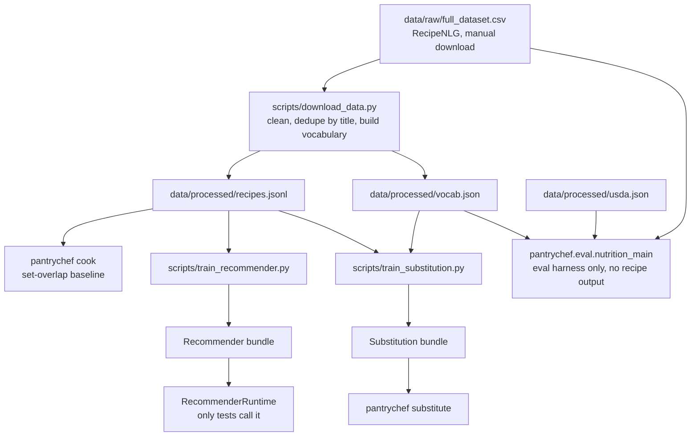

# Architecture

This document describes the code that exists today. The target design is in
[docs/ARCHITECTURE_PROPOSAL.md](docs/ARCHITECTURE_PROPOSAL.md). Update this document in the
same change as the code.

## Principles

1. Logic lives in the package. Scripts in `scripts/` are thin entry points.
2. Each module has one purpose and can be tested alone.
3. Use ML only where it beats a rule on a fair test
   ([ADR 0005](docs/decisions/0005-honest-claims-and-eval-reset.md)).
4. `uv.lock` pins the environment. Data and models are not in git.

## Data flow today

This diagram shows only built code. The corpus is RecipeNLG, for research only
([ADR 0003](docs/decisions/0003-licence-clean-recipe-corpus.md)). No part of this flow
ships in a public app.

Known breaks in this flow are in
[docs/PROJECT_STATE.md, section 4](docs/PROJECT_STATE.md#4-actual-data-flow-today).

## Modules

| Path | Built | Planned |
| --- | --- | --- |
| `pantrychef/config/` | Typed runtime settings | No change |
| `pantrychef/common/` | Logging and shared types | No change |
| `pantrychef/data/` | RecipeNLG loading, cleaning and storage | Source adapters for Wikibooks and Open Recipes in `pantrychef/sources/` (M1) |
| `pantrychef/ingredients/` | Rule-based parser and vocabulary match | Curated table and resolver (M3) |
| `pantrychef/retrieval/` | Inverted index and set-overlap baseline | Research code. The new engine reuses ideas, not this runtime |
| `pantrychef/recommender/` | Candidate pool, features, linear and LambdaMART rankers, bundle, runtime | Research code. A small ranker may ship if it passes M4 |
| `pantrychef/substitution/` | Word2vec arm, context graph arm, blend, bundle | Retrain on Open Recipes and export a table (M5) |
| `pantrychef/dietary/` | Token-based tagger. Not safe to rely on | Three-state flags from the table (M5) |
| `pantrychef/nutrition/` | USDA matcher, mass rules, aggregation, gated imputer. Not fit to show | Gated on validation (M9) |
| `pantrychef/eval/` | Evaluation harnesses for each research phase | New protocols and results files (M2) |
| `pantrychef/cli.py` | `cook` and `substitute` commands | `cook` calls `answer()` (M1) |
| `pantrychef/pack/`, `pantrychef/engine.py` | None | Pack builder and reference engine (M1) |
| `web/` | None | TypeScript engine and app (M1, M6) |

## Tooling

| Purpose | Built | Planned |
| --- | --- | --- |
| Environment | `uv`, `uv.lock` | No change |
| Lint and format | `ruff`, pre-commit | No change |
| Tests | `pytest` | Vitest and Playwright for `web/` (M1) |
| CI | Lint, format, tests and CLI start on Linux and Windows, and `pip-audit` | Parity tests and an evaluation floor (M1, M2) |
| Runtime config | `pydantic-settings` | No change |
| Experiment records | None | `results/*.json` files (M2) |
| Hosting | None | GitHub Pages (M1, needs owner confirmation) |
