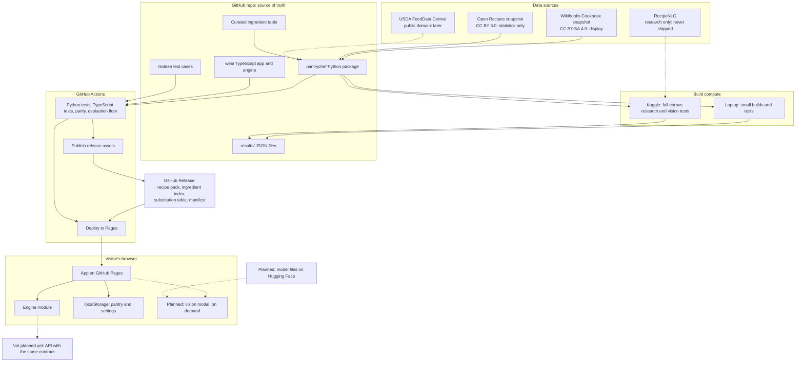
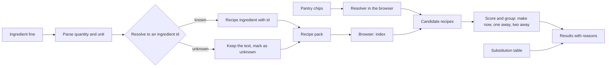

# Architecture proposal

Status: proposed on 2026-10-30. Nothing in this document is built unless it says so.
Decisions: [ADR 0003](decisions/0003-licence-clean-recipe-corpus.md),
[ADR 0004](decisions/0004-static-first-browser-engine.md),
[ADR 0005](decisions/0005-honest-claims-and-eval-reset.md).

## 1. Summary

PantryChef becomes a static web app. The browser does the search. Python builds the
data files before release. No server runs in the first release.

| Stage | Where it runs | What it does |
| --- | --- | --- |
| Build | GitHub Actions, the laptop, or Kaggle | Parse recipes, resolve ingredients, mine substitutions, evaluate, and write artifacts |
| Release | GitHub Releases | Store versioned artifacts with hashes |
| Serve | GitHub Pages | Serve the app and the data pack as static files |
| Use | The visitor's browser | Search, score, explain, and save the pantry |

## 2. System diagram



## 3. Component boundaries

| Component | Location | Input | Output | Status |
| --- | --- | --- | --- | --- |
| Source adapters | `pantrychef/sources/` | Snapshot file | `SourceRecipe` records with provenance | Planned |
| Line parser | `pantrychef/ingredients/` | Ingredient line | Quantity, unit, ingredient text | Built; needs Unicode fractions and tests against real lines |
| Ingredient table | `data/ingredients/ingredients.csv` | Hand curation | Ids, names, synonyms, roles, diet flags | Planned |
| Resolver | `pantrychef/ingredients/resolve.py` | Text | Ingredient id or "unknown" | Planned |
| Pack builder | `pantrychef/pack/` | Records and table | Recipe pack and manifest | Planned |
| Reference engine | `pantrychef/engine.py` | Pantry ids, settings | `Answer` | Planned |
| Substitution mining | `pantrychef/substitution/` | Open Recipes as ingredient sets | Top-k table with evidence | Built for RecipeNLG; needs retraining and table export |
| Evaluation | `pantrychef/eval/` | Engine, gold sets | `results/*.json` | Partly built; new protocols planned |
| Browser engine | `web/src/engine.ts` | Pack, pantry | `Answer` | Planned |
| App | `web/src/` | Engine module | Screens | Planned |

Rules:

- One function, `answer()`, defines the behaviour. The TypeScript engine must match it.
- The app calls only the engine module. It does not read data files.
- Only the pack builder decides which data ships. It reads only input files on a hash
  allow-list, and a test fails if it opens any other data file. Comparing words cannot
  find derived data, so the control is on inputs and on a provenance column in the
  ingredient table.
- `LICENSES.md` lists the licence of each path and artifact. Committed recipe text, such
  as test fixtures, sits under a path with a CC BY-SA notice.

## 4. Data flow



A recipe has lines. Each line holds a set of acceptable ingredient ids, because 1,517
of about 3,800 recipes have an "or" line. A line also has an `optional` flag and a
`read` flag.

A line that cannot be read counts as missing and appears with its original text as
"check this line". The app never hides it. The share of recipes with unread lines is a
reported metric (see M3). Do not reduce the pack to fully read recipes before you
measure the cost: a table with 2,000 rows fully covered only 53.4% of Wikibooks recipes
before collapsing.

## 5. Contract

Python dataclasses in `pantrychef/engine.py` and hand-written types in
`web/src/types.ts` define this contract. There are about 10 types, and the golden tests
catch drift, so we use no code generation.

```text
AnswerRequest   pantry: ingredient_id[], staples: ingredient_id[], diet: Diet | null, limit: int
Answer          groups: { make_now, one_away, two_away }, unlocks: Unlock[], blockers: Blocker[],
                unknown_pantry: string[], pack: PackInfo
Unlock          ingredient_id, name, recipes: int    (items that would move the most recipes to make now)
Blocker         kind: clear_diet | add_item, ingredient_id: ingredient_id | null, name, recipes: int
                (shown on zero results)
RecipeResult    recipe_id, title, have: int, total: int, missing: Missing[], unread: int,
                diet_state, reasons: string[]
Missing         options: ingredient_id[], text, swap: SwapHint | null
SwapHint        ingredient_id, name, source: curated | mined, ratio: string | null, note: string | null
RecipeDetail    recipe_id, title, lines: Line[], steps: string[], servings?, time?, category?, source: Attribution
Line            text, options: ingredient_id[], optional: bool, read: bool
Attribution     url, revision_id, licence, retrieved_on, changes: string | null
Diet            vegetarian | vegan | gluten_free | dairy_free
DietState       fits | does_not_fit | unknown
PackInfo        version, commit, corpus_fingerprint
```

The engine module exports `ready`, `suggest`, `answer`, `recipe` and `swaps`. A base
URL in one config value locates the data files. If an API becomes necessary, only this
module changes. We add a Web Worker only if latency measurements need one.

## 6. Search and scoring

The display corpus has about 3,800 recipes. An exact scan is possible, so approximate
search and the old candidate ceiling do not apply to the product.

1. Treat staple lines as satisfied.
2. For each recipe that shares at least one ingredient with the pantry, count missing
   required lines. A line is satisfied if the pantry holds any id in its set. An unread
   line counts as missing. An optional line never counts.
3. Group by missing count: 0, 1, 2.
4. Inside each group, sort by length-normalised IDF cosine, then by fewer total lines,
   then by recipe id. IDF means inverse document frequency. It gives rare ingredients
   more weight. This is the one canonical order. Other documents link here.
5. Compute `unlocks`: for each ingredient missing from a one-away recipe, count the
   recipes it completes. Show the top items. This is the core promise, "the one item
   that unlocks more". Sort by count, then by ingredient id.
6. If all groups are empty, compute `blockers`: the single change that returns the most
   results. A change is either clearing the diet filter or adding one item. Removing a pantry
   item never helps, because it cannot reduce a missing count. Until diet flags land in M5,
   only `add_item` applies. Sort by count, then by ingredient id.

The score in step 4 is `sum(idf(i) for i in pantry and recipe) / sqrt(sum(idf(i) for i in
recipe))`. The name "IDF cosine" is shorthand, because this is not a true cosine. M4 may change
it, and the Python and TypeScript engines change together. The diet filter runs before step 3,
so `groups`, `unlocks` and their counts all reflect it.

The learned ranker replaces only the first sort key in step 4, and only if it wins the
test in [ADR 0005](decisions/0005-honest-claims-and-eval-reset.md). Grouping stays,
because it is the product promise and users can understand it.

IDF values come from Wikibooks, or from Open Recipes if an experiment shows they
rank better. The evaluation decides.

## 7. Artifacts and versioning

| Artifact | Format | Size target | Source |
| --- | --- | --- | --- |
| `core.vN.json.gz` | Ingredients, recipe lines as ids, titles, IDF, curated swaps | Under 3 MB | Table, Wikibooks |
| `text.vN.json.gz` | Full recipe text, CC BY-SA 4.0 | Under 7 MB, so core and text stay under the 10 MB in ADR 0003 (ESTIMATE; a rough trim with steps measured 1.2 MB gzipped) | Wikibooks |
| `mined.vN.json.gz` | Mined swaps with evidence, only if M5 passes | Under 2 MB (ESTIMATE) | Open Recipes |
| `manifest.vN.json` | sha256, size, commit, input hashes, licence of each file, metrics | Small | Pack builder |

The core file loads first. Full recipe text loads when needed.

- GitHub Releases holds immutable artifacts by tag. Git holds no generated data.
- The Pages build downloads release assets and checks the hashes.
- We do not use DVC. The manifest and tags give enough provenance at this size.
- Each result in `results/` records commit, dirty flag, config, corpus fingerprint,
  seed, metrics and the command.

## 8. Parity between Python and TypeScript

`scripts/make_golden.py` runs `answer()` on about 200 fixed pantries over a small
committed fixture pack. It writes the groups, the order and the scores. A Vitest test
runs the TypeScript engine on the same cases. Scores must match within 1e-9, and the
order must match exactly. CI regenerates the file and fails if it changes without a
commit.

## 9. Kaggle

ADR 0003 removes full-corpus processing from the product build. Parsing Open Recipes
and building the pack should fit on the laptop or in CI (HYPOTHESIS: under 20 minutes
on a sample-based estimate). Kaggle remains for:

- Retraining mined substitutions on Open Recipes.
- Research on RecipeNLG: rule baselines at 1.27M recipes, which replace the retracted
  full-corpus claim. No output ships.
- Vision evaluation and quantisation tests.

The flow is: build a wheel at a tagged commit, upload it with the data as a private
Kaggle Dataset, run a thin script with `kaggle kernels push`, pull outputs, and check
hashes. Notebooks hold no logic. No GitHub, Hugging Face or other token enters a
Kaggle kernel. Kaggle quotas come from secondary sources, so check them on the first
run.

## 10. Vision (planned, gated)

- An on-device model, SigLIP2 or OpenCLIP with a permissive licence, matches image
  tiles against precomputed text embeddings for about 150 to 200 visible ingredients.
- The model loads only after the user asks, with a size warning. Files live on Hugging
  Face.
- Output is a checklist. Nothing enters the pantry without user action.
- Photos stay on the device. A Content Security Policy limits connections, and a test
  checks it.
- The feature ships only at a per-photo F1 of 0.5 or more and 5 or fewer edits per
  photo on a test set of 100 to 150 photos. If it fails, it does not ship.

## 11. Security and privacy

- The app has no server, no accounts, no secrets and no analytics in the first release.
- GitHub Pages cannot set response headers, so the Content Security Policy is a meta
  tag. It limits scripts and connections to known hosts. A meta tag cannot set
  `frame-ancestors`, so clickjacking protection is not available. The app has no
  sensitive action, so we accept this.
- All recipe text renders as text. It never renders as HTML. Wikibooks text is
  public input.
- Pack source links must start with `https://en.wikibooks.org/`. The builder rejects
  others, so a page cannot inject a `javascript:` link.
- The app validates and size-limits imported pantry files and shared URLs.
- Pin GitHub Actions by SHA. Use least-privilege permissions. Run `pip-audit` in CI.

## 12. Trade-offs

| Choice | Gain | Cost |
| --- | --- | --- |
| Wikibooks for display | Clear public right and full steps | 3,800 recipes and thin "make now" lists for some pantries |
| Browser engine | Free, private and durable | Two implementations held by parity tests |
| No API | Nothing to host | No heavy models on a server, and free text is limited |
| Curated table | Trustworthy names, flags and roles | Manual work; on Wikibooks before collapsing, 500 rows cover 75.4% of mentions and 16.1% of recipes in full |
| Deterministic scoring first | Explainable, and hard to fool | Less ML in the product until a ranker earns its place |

## 13. What this changes in the current code

| Code | Plan |
| --- | --- |
| `retrieval/`, `recommender/` | Keep as research and history. The new engine reuses ideas, not the runtime |
| `substitution/` | Keep. Retrain on Open Recipes. Export a table |
| `nutrition/`, `dietary/` | Keep nutrition unshipped. Replace the dietary tagger with table flags |
| `vision/`, `serving/` stubs, Hydra configs, MLflow, Docker placeholders | Deleted in M0 |
| `data/nutrition/aliases.json` | Unused in v1. Review its origin at M9 |
| `cli.py` | Change `cook` to call `answer()` |

## 14. Proposed direction: graph knowledge base with ML on top

Status: proposed, not accepted. [ADR 0006](decisions/0006-hybrid-graph-knowledge-base.md)
records it. Nothing in the sections above depends on it.

The owner intends a classical ML-backed project. The idea is a typed ingredient and recipe
graph, shipped as a static artifact, with ML for retrieval, ranking, ingredient
understanding and recommendations. It fits ADR 0004, because traversals can be precomputed
at build time. A spike in M3 decides whether the graph stays. ADR 0005 still decides whether
each model ships. If the spike fails, the design above stands, with a flat table.

## 15. Open questions

These do not block M0 or M1.

- Is 3,800 recipes enough for return visits? User testing will tell.
- How good is mined substitution at 168k recipes? The rating test will tell.
- What is the real latency on a low-end phone? The thin slice will measure it.
