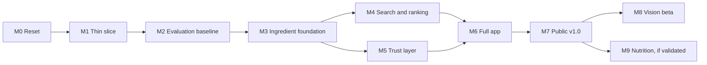

# Development plan

Status: proposed on 2026-10-30. Effort figures are estimates for one person.

This plan sets milestones and acceptance criteria. Before each milestone, write a
task-level plan in `docs/plans/`. Each milestone needs tests, documentation updates,
a regression check and an independent review. Milestones with ML work also need an
evaluation result in `results/`.

## Dependency map

M4 and M5 can run in parallel, because they touch different code. All others run in
order. M8 and M9 are independent of each other.

## M0: Reset (2 to 3 days)

**Objective:** make the repo honest and easy to run.

- Merge PR #5.
- Fix the fresh-clone quickstart.
- Rewrite `README.md` and `ARCHITECTURE.md` with Built and Planned columns.
- Flag stale numbers in the model cards and in `docs/EVALUATION.md`.
- Delete Hydra configs, MLflow, the Docker placeholders, the `vision` and `serving`
  stubs, and `notebooks/`.
- Add `.gitattributes` with LF line endings. Bump the pre-commit ruff version. Set the
  package version to the current release.
- Add `pip-audit` to CI. Upgrade the lock file.
- Add `LICENSES.md`. Record each corpus snapshot source and hash in `docs/DATASET.md`.

**Acceptance:**

- A fresh clone passes the README quickstart on Linux and Windows.
- All tests pass.
- Every README claim links to code or a results file, or it says "retracted" or "planned".
- `pip-audit` shows no unreviewed finding.

**Tests:** a CI job that runs the exact quickstart commands.

M0 also records the proposed graph direction in
[ADR 0006](decisions/0006-hybrid-graph-knowledge-base.md).

## M1: Thin slice (about 2 weeks)

**Objective:** a real person can use a real, small version, so contract problems appear
early.

- Write `scripts/fetch_wikibooks.py`. It uses the official MediaWiki API, within its rate
  rules, and records a revision id per page. Store the snapshot hash and a release copy.
- Add the Wikibooks source adapter, with provenance for each recipe.
- Add a first table: rule-based normalisation and a small hand list. It must not use
  `data/processed/vocab.json`.
- Add the pack builder with its input allow-list and guard test. This must land before
  any deployment.
- Write `answer()` and `cook` on top of it, including `unlocks` and `blockers`.
- Create `web/` with Vite, TypeScript and Preact. Add a pantry screen and a results screen.
- Add golden parity tests and deploy to GitHub Pages. This step publishes a site, so
  the owner confirms it first.

**Acceptance:**

- The hosted page returns grouped results and top unlocking items with no local service.
- Parity holds on the golden cases.
- The guard test fails on a build that opens a file outside the allow-list.
- Core data download is under 3 MB.
- Measured search latency on a throttled low-end profile is under 100 ms, or the result is
  recorded with a Web Worker plan.
- Each recipe shows its source link, revision and licence.

**Tests:** parser fixtures from real Wikibooks lines, including Unicode fractions and "or"
lines, under a CC BY-SA notice. A Playwright smoke test of the journey. Parity tests.

## M2: Evaluation baseline (about 1 week)

**Objective:** measure before changing anything.

- Add the results-file helper. Link existing claims to it.
- Add the no-ML rule and the IDF rule to the leaderboard.
- Add distractor pantries with at least 2 samplers, with paired confidence intervals.
- Add "makeable at k" as a product metric only.
- Write the judging protocol and pilot it on 20 pantries.
- Build a 300-line hand-labelled parser gold set. Split it into dev and test.
- Split the 166 realistic inputs into dev and test before any table work.
- Research on Kaggle (this is the first Kaggle job, and it needs approval): rule baselines on
  RecipeNLG at 1.27M recipes. This replaces the old 7.7 times claim. No output ships.

**Acceptance:**

- A single documented command rebuilds each table in `docs/EVALUATION.md`.
- Old recovery results appear only as a sanity check, and the rule is next to them.
- The metric that picks a ranker is not a function of its own features.
- The Kaggle flow runs at a pinned commit and returns hashed results.

**Tests:** metric unit tests with hand-computed values. A small-fixture floor as a CI
gate.

## M3: Ingredient foundation (3 to 4 weeks)

**Objective:** one trusted ingredient table.

- Add rule-based collapse of size, container and preparation words, and fix the
  singulariser.
- Grow the table in measured steps from 500 rows. About 1,700 rows reach 90% of
  mentions, and 2,000 rows fully cover only 53.4% of recipes, so the 60% target needs more than
  2,000 rows (MEASURED before collapsing). Collapse may reduce this.
- Add synonyms and UK and US names. Consider the Epicure vocabulary only if its licence and
  source provenance are both clear.
- Add a resolver with exact, synonym and fuzzy steps, plus a matching browser version.
- Support sets of ids per line, plus optional and unread flags.
- Decide whether the black pepper staple satisfies a bare "pepper" line. There are 510
  such lines, and some are not black pepper.
- Rebuild the pack with the table. Measure coverage.
- Run the graph spike in [ADR 0006](decisions/0006-hybrid-graph-knowledge-base.md), and accept
  or reject that ADR. Allow for `is_a` and `form_of` columns in the table.

**Acceptance:**

- At least 90% of Wikibooks mentions resolve correctly, on a hand-checked test sample.
- At least 60% of recipes have every required line read, and the pack keeps at least 2,500
  recipes. Unread lines appear as "check this line".
- At least 90% of the held-out realistic inputs resolve correctly. The combined baseline is
  0.82 to 0.86.
- If a target fails, stop and report to the owner. Do not lower it silently.

**Tests:** resolver table tests, parity tests and the guard test.

## M4: Search and ranking (about 2 weeks)

**Objective:** the best honest ranking, and the recommender deliverable.

- M1 builds staples, grouping and IDF ordering. Refine them here, and run the IDF variants.
- Add recipe-quality signals from structure and any others that pass review.
- Build the hand-judged set now, on the post-M3 pack: 100 pantries, top 5 from 3 systems,
  with pairwise preference. Up to about 1,500 judgments. Split by pantry: 60 dev and 40 test.
- Train a small pairwise model with few features (IDF, typicality, structure) on the dev
  judgments, with cross-validation. Judgments are too few for LambdaMART, but they may
  suit a small linear model (HYPOTHESIS).
- Compare the model and the rule on the test pantries, with paired intervals.

**Acceptance:**

- The model ships only if the paired 95% interval of its gain over the IDF rule excludes zero.
  Otherwise, the rule ships. A written decision records the evidence.
- A result file exists for each arm.
- Any shipped model runs in the browser and passes parity.

**Tests:** ordering tests, checks that test pantries are absent from training, and a pinned
ordering for golden pantries.

## M5: Trust layer (2 to 3 weeks)

**Objective:** dietary and substitution output that people can trust.

- Add three-state diet flags from the table. A composite is unsafe if any part is
  unsafe. Unknown items show as unknown.
- Add a curated functional table of 200 to 300 swaps, with ratios and notes. If a row
  draws on the Wikibooks substitution page, that file is CC BY-SA and the manifest says so.
- Retrain mining on Open Recipes on Kaggle. Restrict it to the same role. Export the top-k
  table with evidence fields.
- Ship mined swaps only if they pass the test below. Curated swaps ship regardless.
- Show a swap only when evidence exists. Otherwise, show "no confident swap".

**Acceptance:**

- Dietary: a hand-labelled gold set of 300 items, separate from the table's own review.
  It has no false "fits" on the test split. At most 30% of recipes are "unknown" for each
  diet, so the rule cannot pass by marking everything unknown. The tautological metric is
  deleted.
- Substitution: a blind rating of 30 to 50 queries by 2 raters. Mined swaps ship only if
  at least 70% are rated "I would use this", against the current top-1 as comparison.
- Graph and embedding are compared on a clean test split with paired intervals.
- Each shown swap has a plain reason from real data.

**Tests:** the adversarial list from the audit (egg noodle, peanut butter, rice and
others) as regression tests.

## M6: Full app (about 2 weeks)

**Objective:** a product, not a demo.

- Build the screens in [PRODUCT_VISION.md](PRODUCT_VISION.md): recipe detail, swaps,
  saved pantry, export, shared links, and empty and error states. Category filters come
  later, because the Wikibooks categories mix cuisine and dish type.
- Add wording rules, attribution and a method page.

**Acceptance:**

- An axe scan has no serious issue, and keyboard and screen reader passes are recorded.
- The layout reflows at 320 px wide, which equals 400% zoom on a 1280 px screen.
- 5 people complete the core tasks unaided, and the problems they find are recorded.
- The Content Security Policy is on and tested.

**Tests:** Playwright journeys on mobile and desktop profiles, plus import validation.

## M7: Public v1.0 (about 3 days)

**Objective:** a durable public release.

- Add the release workflow, manifest checks and an evaluation floor in CI.
- Write `docs/USER_GUIDE.md`, `docs/DEPLOYMENT.md`, `docs/DATASET.md` and `docs/MODELS.md`.
- Make the public announcement, after owner confirmation.

**Acceptance:**

- A clean machine can reproduce the pack from a tag, with matching hashes.
- The hosted site works with no local service, on a real phone and on a desktop.
- A licence review of each shipped file is recorded.

## M8: Vision beta (about 1 to 2 weeks, gated)

**Objective:** photo suggestions, if they work.

- Write the visual vocabulary and the photo test set of 100 to 150 images.
- Test tiled SigLIP2 and OpenCLIP on Kaggle, plus a calibration step.
- Add the browser version only if the test passes.

**Acceptance:** per-photo F1 of at least 0.5, 5 or fewer edits per photo, and model size
and phone latency recorded. The user always reviews the list. If the gate fails, write
up the result and do not ship.

## M9: Nutrition (about 1 to 2 weeks, gated)

**Objective:** show estimates only if they are defensible.

- Fix USDA default matching, portions and mass rules.
- Validate on 500 USDA FNDDS recipes. FNDDS data is structured, so also test parsing on
  hand-checked Wikibooks lines. 13% of Wikibooks recipes have no amounts, so those recipes
  show no estimate.

**Acceptance:** at least 70% of recipes within 25% of the reference calories. Each
display shows a range and coverage. No single calorie figure appears. If this fails,
nutrition stays out. The targets are proposals and need review at that time.

## Portfolio coverage and its honest limit

ADR 0003 trades data scale for a clean public right. This table shows what the plan
demonstrates, and what remains if every gate fails.

| Skill | Delivered by | Certain or gated | If gates fail |
| --- | --- | --- | --- |
| Data engineering | Fetcher, adapters, pack builder, manifest. Scale only in research | Certain | Unchanged, but small scale in product |
| Information retrieval | Index, IDF ordering in browser, protocols | Certain | Unchanged |
| Recommendation | Small ranker with judged data | Gated (M4) | The IDF rule ships. A published negative result remains |
| Knowledge graph | Ingredient table with roles and relations. Mined context graph is research | Partly certain. Table is certain, graph in product is gated (M3 spike in ADR 0006, M5) | A table, not a true graph, in the product |
| Hybrid graph with ML on top (proposed, [ADR 0006](decisions/0006-hybrid-graph-knowledge-base.md)) | Typed graph artifact, a build-time mention classifier, edge proposals, graph features in the ranker | Gated. The M3 spike decides the graph. Each model must beat its no-ML baseline on a test fixed in advance (ADR 0005 rules apply) | Flat table and rules. Results stay as research |
| Practical ML | Mined swaps, ranker | Gated (M4, M5) | Research results only |
| Computer vision | Tiled image-text matching | Gated (M8) | A published test, no feature |
| Model optimisation | Vision quantisation tests. Small ranker in browser | Gated (M8, M4) | Measurements only |
| Evaluation discipline | Audit, new protocols, paired intervals | Certain | Unchanged, and this is the strongest story |
| MLOps | Kaggle flow, results files, release manifest, parity and evaluation gates in CI | Certain | Unchanged |
| Full stack and deployment | TypeScript engine and app on Pages | Certain | Unchanged |
| Product thinking | Research, user tests, wording rules | Certain | Unchanged |

The owner intends a classical ML-backed project. ADR 0006 records that direction as a
proposal. It adds tests, and it does not remove any gate, so the worst case below stays
possible.

Worst case: if all gates fail, the product is deterministic, with no ML in the browser.
The ML work then exists as honest research results. That would still be a useful product,
but a thinner ML portfolio. If you want stronger certainty, the best addition is a gated
"more recipes" research track on the full RecipeNLG corpus on Kaggle, kept private.

## Cross-cutting rules

- Do only one dependent task at a time. Run independent tasks in parallel.
- Measure before optimising. Record latency, memory and size.
- Never change a metric definition and a model in the same step.
- Use isolated worktrees for agents that change code.

## Risks

| Risk | Effect | Response |
| --- | --- | --- |
| Too few recipes for some pantries | Thin results | Promote "one item away". Test before adding a corpus |
| Table work grows | Delay | Start at 500 rows. Limit the pack to covered recipes |
| Ranker loses | Less ML in product | Ship the rule. Publish the result |
| Mined swaps stay weak | Lower ML depth | Curated table still serves users. Report honestly |
| Vision fails its gate | No photo feature | Ship without it. Publish the test |
| Open Recipes statistics challenged | Rebuild needed | Replace from Wikibooks alone. Artifacts are versioned |
