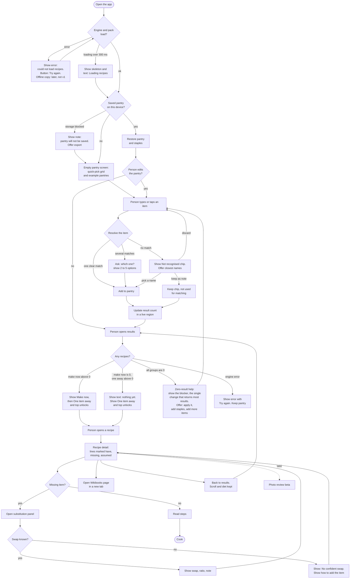
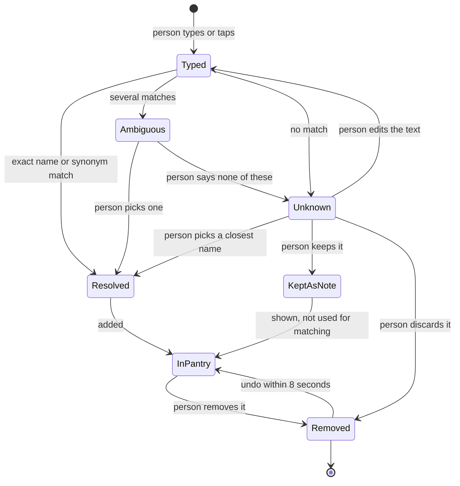

# PantryChef product vision

Status: draft for owner review. Date: 2026-10-30.
Readers: the project owner, and any designer or developer who builds the app.

This document says what PantryChef is, who it is for, and how it should look and behave.
It does not describe built software. Nothing in the web app exists yet. Every feature
below is **planned** unless the text says otherwise.

Decisions that bind this document: [ADR 0003](decisions/0003-licence-clean-recipe-corpus.md),
[ADR 0004](decisions/0004-static-first-browser-engine.md) and
[ADR 0005](decisions/0005-honest-claims-and-eval-reset.md). Research is in
[RESEARCH_FINDINGS.md](RESEARCH_FINDINGS.md) and
[the Stage 1 reports](research/2026-10-stage1/README.md).

Terms used in this document:

- **Pantry**: the list of ingredients a person says they have.
- **Staple**: an ingredient the app assumes the person has, such as salt. The person can change this.
- **Pack**: the one versioned file that holds all recipes the app can show.
- **Engine**: the code that matches a pantry to recipes. It runs in the browser.
- **Ingredient table**: the curated list of ingredient names, synonyms and diet flags. It is planned. It does not exist yet.
- **WCAG**: Web Content Accessibility Guidelines. Version 2.2, level AA, is the target.
- **Wikibooks Cookbook**: the open cookbook at en.wikibooks.org. It is the source of every recipe the app shows.

## 1. The problem

A person opens the fridge. They see eggs, rice and half an onion. They do not know what to cook.

Search does not help much. A search for "eggs rice onion" returns pages with long stories,
adverts, and recipes that need ten more items. The person must read many pages to learn
which ones they can cook today.

Pantry apps exist. Some ask for a lot of typing and some hide the useful part behind a
paid plan or a sign-in (DOCUMENTED, report 04; competitors in
[RESEARCH_FINDINGS.md](RESEARCH_FINDINGS.md) section 5). Report 04 also notes that
Yummly closed in December 2024 and that its users lost saved data unless they exported it.

## 2. Who it is for

- A home cook with a half-full fridge and no plan.
- A student or anyone who cooks on a budget.
- A person who wants to waste less food.

These groups come from reasoning, not from user research (HYPOTHESIS). The project has no user data.

It is not for: people who need medical or allergen advice, meal planners, or people who want
photos and ratings.

## 3. The one promise

> Tell me what I have. Show what I can cook now. Show the items that move the most recipes to make now. If I get no results, show the single change that returns the most results.

The engine returns these as `unlocks` (top items that move the most recipes to make now) and
`blockers` (on zero results, the single diet or pantry change that returns the most results).
See [ARCHITECTURE_PROPOSAL.md](ARCHITECTURE_PROPOSAL.md) section 6.

Every screen must serve this promise. If a feature does not serve it, the feature waits.

## 4. What makes it better than search

| Search | PantryChef (planned) |
| --- | --- |
| Starts from a dish name | Starts from your items |
| Cannot tell what you lack | Shows "you have 6 of 8" and names the missing item |
| Page full of adverts and long text | Plain recipe, one column, no adverts |
| Needs a sign-in on many sites | No account. Your pantry stays on your device |
| Sends your query to a server | Matching runs in your browser (ADR 0004) |
| Shows one dish | Shows "add scallion to move 7 recipes to make now" |

The last row is the main difference. A search engine cannot know your pantry. PantryChef can
rank by what you lack, not only by what you have.

## 5. What it will not do

- It will not give allergen, medical or nutrition advice. See section 11.
- It will not show nutrition numbers in the first release (ADR 0005).
- It will not use accounts, advertising, analytics or tracking of people.
- It will not show photos of dishes. See section 6.
- It will not claim that a recipe is "safe", "healthy" or "vegan" as a fact. See section 11.
- It will not use a chat bot or "AI chef".
- It will not scan a photo in version 1. Photo input is a later beta, and only if it passes its own test (report 03).
- It will not claim that the recommender "beats" any other method. ADR 0005 retires that claim.

## 6. The data as it is

All recipes come from the Wikibooks Cookbook snapshot of 2024-07-31 (ADR 0003). The snapshot
is **untrusted downloaded data**. We read it with an isolated Python process and examined
40 random recipes plus counts over the whole file (MEASURED, 2026-10-30, by the author of this
document). Counts come from a strict rule: pages with at least two list items under an
"Ingredients" heading.

### 6.1 What the data holds

| Field | Fact | Source |
| --- | --- | --- |
| Pages in the file | 3,895 | MEASURED |
| Pages with an ingredient list | 3,800 | MEASURED, matches ADR 0003 |
| Ingredient lines per recipe | Median 8. 10th percentile 4. 90th percentile 14. Maximum 42 | MEASURED |
| Instruction text | Median about 500 characters. 4 recipes have none. 75 have under 80 characters | MEASURED |
| Category | In about 97% of pages. It is a mix of dish type and cuisine | MEASURED |
| Difficulty | A number from 1 to 4 on 3,769 of 3,895 pages | MEASURED |
| Servings | About 33% of recipes. Free text such as "8 (2 pieces each)" or "~75" | MEASURED |
| Time | About 33% of recipes. Free text such as "Prep: 20 minutesBaking: 60 minutes" | MEASURED |
| Images | None. The file has no image reference. A search of the whole file found 0 matches | MEASURED |
| Damaged characters | 0 lines with the replacement character | MEASURED |
| Duplicate titles | 0 | MEASURED |

The data fields are `url`, `title`, `infobox` (category, servings, time, difficulty) and
`text_lines` (text, line type, section).

### 6.2 What this means for the design

- **No images.** The snapshot has no images. Wikimedia images have their own licences, one per
  file. The app will not load images from Wikimedia in version 1. Cards use text only.
- **Servings and time are free text.** The app shows them only as the page wrote them, and only
  when they are short and clear. It never does arithmetic on them.
- **Difficulty is a 1 to 4 number of unknown quality.** Treat it as a hint. Do not filter on it in version 1.
- **Category is two things in one.** "Dessert_recipes" is a dish type. "Nigerian_recipes" is a
  cuisine. The most common values are Dessert (279 pages), Soup (245), Beverage (145), Chicken (142)
  and Nigerian (139) (MEASURED). 118 pages have no category. 33 point to a page that does not exist.
  A category filter is not in version 1. It comes later, after cleaning (section 15.2).
- **Ingredient lines are real kitchen text.** Examples from the sample:
  - `½ litre (1 pint) yoghurt` (a Unicode fraction and a metric/imperial pair)
  - `2–3 teaspoons sugar` (a range with an en dash)
  - `1 can (28 oz / 830 g) crushed tomatoes` (a size in brackets)
  - `Beef`, `Liver`, `Water`, `Onion` (no quantity at all)
  - `Salt to taste`
  - `Tortilla chips or fritos for serving` (an optional serving item)
  - `1 large jar of Alfredo sauce` (a ready-made product)
  - `Pizza dough (e.g. Basic Pizza Crust or a ...)` (a link to another recipe)
  About 27% of ingredient lines do not start with a number or fraction. About 10% hold an
  "or" or a slash. About 20% hold a bracket. The engine must handle all of these.
- **Instructions are short.** The sample runs from one line ("Stir all ingredients together well.",
  35 characters) to 21 steps (Black Forest Cake). The app must show the full text of the page. It
  must not present it as a lesson for a beginner.
- **Some pages are weak.** Page text can hold leftovers from the wiki. We found 57 lines that hold
  `Template:Nutritionsummary` or similar. The pack build must remove them (planned).
- **Some recipes are lost by a strict rule.** 95 pages fall outside the 3,800. Some are real
  recipes whose ingredients sit under a heading such as "Variation I", or in a numbered list. Others
  have no ingredient list at all (for example "Apple Potato Bread"). So 3,800 is a lower bound for
  what the pack could hold, not an exact limit. The build should recover the first kind (planned, not measured).
- **The mix is not even.** Nigerian recipes are the 5th largest category. Many of them list
  ingredients with no amounts. This is a strength for variety. It is a weakness for matching,
  because "pepper" and "fresh pepper" can mean different things.

### 6.3 Pantry yield

ADR 0003 measured how many recipes ten hand-written test pantries match. The rule was loose.
The numbers are indicative and are not an evaluation (MEASURED, 2026-10-30).

| Result | Range over 10 test pantries |
| --- | --- |
| Make now (0 items missing) | 1 to 73 recipes |
| One item away (up to 1 missing) | 69 to 330 recipes |
| Up to 2 missing | 267 to 719 recipes |

The "one item away" column is cumulative: it counts recipes with up to one item missing, so it includes make-now recipes.
Hit-rate figures such as 0.985 are vocabulary hit rates, not parse accuracy. A hand read of 60 lines found at least 4 clearly wrong (one rater, not blind).

A stricter rule (recipe staples only, unread lines count as missing) gave Wikibooks 0 to 28 make-now
recipes and 50 to 134 at exactly one item away, across 10 hand-written pantries. Some strict make-now results are trivial, such as "Steamed Rice".

The smallest pantry in the test (a "tiny" one) matched 1 recipe to make now. So "one item away"
carries the experience, as ADR 0003 says. See the risks in section 15.

## 7. Product principles

1. The pantry is the start of every journey.
2. Show what is missing, in words, not only a score.
3. Never lose the person's pantry. Keep it on the device. Let the person export it.
4. Never drop an input silently. Show what the app did not understand.
5. Never claim more than the data supports. Say "looks like" and "about".
6. The recipe belongs to the Wikibooks authors. Show the credit on every recipe.
7. Plain text first. The app must work without images, without sign-in and without a server.

## 8. User journey

The flowchart shows all paths, including empty, zero-result and error paths. Boxes with
"later" belong to a later release.



Notes on the paths:

- **Empty pantry:** the screen shows the quick-pick grid and example pantries. It never shows a blank page.
- **Zero result:** the screen shows the `blockers` result, the single change that returns the most results, and offers "Clear the diet filter" or "Add this item", with the count N of recipes. It never shows only "No matching recipes".
- **Error:** the pantry is never cleared by an error.
- **Storage blocked:** private browsing can block local storage. The app says so and offers an export.

## 9. Pantry item states

Each typed item moves through these states.



Rules:

- `Resolved` means the item maps to one entry in the ingredient table.
- `Ambiguous` means more than one entry fits, for example "pepper" (black pepper, bell pepper, chili).
  The app asks. It never picks for the person.
- `Unknown` means no entry fits. The app shows the closest names. It keeps the person's text.
- `KeptAsNote` items appear in the pantry with the label "not used for matching". They are never dropped.
- A removed item can come back for 8 seconds through an Undo button. The same button works with the keyboard.
- The app keeps a count of unknown words on the device only. The person can copy this list to send to the owner (see section 16).

## 10. Screens

Wireframes are text sketches. They show order and content, not final looks. Recipe names and
ingredient lines come from the real snapshot. Counts and pantry contents are illustrative.

### 10.1 Pantry screen

```
+--------------------------------------------------+
| PantryChef                          [Staples: 3] |
+--------------------------------------------------+
| What do you have?                                |
| [ Type an ingredient____________ ] [Add]         |
|   suggestions (list below the box):              |
|   egg | eggplant | egg noodle                    |
|                                                  |
| Your pantry (4)                                  |
| [eggs  x] [potatoes  x] [onion  x] [olive oil x] |
| Not recognised: "xyz"  [Closest names] [Keep] [x]|
|                                                  |
| Quick add                                        |
| [onion] [garlic] [chicken] [pasta] [tomato] ...  |
|                                                  |
| Diet (preference only) [ Set... ]                |
|                                                  |
| [ See recipes: 2 now, 14 one away ]              |
+--------------------------------------------------+
| Your pantry stays on this device. [Export]       |
+--------------------------------------------------+
```

Content rules:

- The text box has a visible label. A placeholder is not a label.
- The suggestions list follows the ARIA combobox pattern (section 12).
- The staples button opens a panel with a check box for each staple.
- The primary button always shows live counts. The counts sit in a live region.
- With 0 items the button reads "Add an item to start". It is disabled with a reason in text.
- With 1 or 2 items the app still shows results. It adds the text "Add more items for better matches".
- The quick-pick grid holds about 40 common items (HYPOTHESIS: choose from the pack's most frequent ingredients).
- The footer holds the export and import buttons and a sentence about local storage.

### 10.2 Results screen

```
+--------------------------------------------------+
| < Pantry     5 items  Diet: vegetarian preference|
+--------------------------------------------------+
| MAKE NOW (2)                                     |
| +----------------------------------------------+ |
| | Spanish Potato Omelette                      | |
| | You have 4 of 4 (salt assumed)               | |
| | Spanish | 20 minutes | 8 steps                | |
| +----------------------------------------------+ |
| ...                                              |
|                                                  |
| ONE ITEM AWAY (14)        Top unlocks: ...       |
| +----------------------------------------------+ |
| | Saffron Rice                                 | |
| | You have 11 of 12. Missing: saffron          | |
| | Swap idea: turmeric (rough idea)             | |
| +----------------------------------------------+ |
|  [Show 10 more]                                  |
|                                                  |
| Diet tags are guesses from ingredient names.     |
+--------------------------------------------------+
```

Content rules:

- A card holds: title, "You have N of M", missing item names, and (when set) a diet pill. It holds no score.
- The card shows one line of reason: "Uses 3 of your 4 items, including eggs". The reason comes from matched and missing items only. It does not come from model internals.
- The category, time and servings appear only when the page has them in a clean form. A card never shows an empty field.
- A card is one link. The whole card is the target. The title is the link text.
- Lists show 10 cards, then a "Show more" button. This avoids long scroll regions.
- "Top unlocks" shows the `unlocks` items, which move the most recipes to make now. The text reads "Add scallion to move 7 recipes to make now". This feature is planned.

### 10.3 Recipe detail

```
+--------------------------------------------------+
| < Results                                        |
| Spanish Potato Omelette                          |
| Category: Spanish recipes | 20 minutes | Serves 4|
| Difficulty 3 of 4 (as rated on the source page)  |
|                                                  |
| You have 4 of 4. Staples assumed: salt           |
|                                                  |
| INGREDIENTS                                      |
|  [have]    8 eggs                                |
|  [have]    1 kg potatoes                         |
|  [have]    1 onion                               |
|  [have]    500 ml olive oil                      |
|  [assumed] Salt                                  |
|                                                  |
| STEPS                                            |
|  1. Peel the potatoes ...                        |
|  2. ...                                          |
|                                                  |
| ------------------------------------------------ |
| From the Wikibooks Cookbook: Spanish Potato      |
| Omelette (link). Text is available under CC BY-SA|
| 4.0 (link). Authors: see the page history (link).|
| Changes: ingredient lines were matched to a list.|
| The wording is unchanged.                        |
+--------------------------------------------------+
```

Content rules:

- Each ingredient line is shown as the page wrote it. The status label and an icon sit beside it.
  Status never relies on colour alone.
- Staples assumed are shown in the list, not hidden.
- A line the engine could not read shows "Check this line". It counts as missing for "make now".
- Steps are the page's own numbered list.
- The attribution block is part of the recipe. It is not in a footer that can scroll away (section 13).
- A link to the source page opens in a new tab. The link text says "Open on Wikibooks (new tab)".

### 10.4 Substitution panel

The panel opens from a missing line. On a phone it is a bottom sheet. On a wide screen it is a side panel.
In both cases it is a dialog with a close button and an Escape key.

```
+--------------------------------------------------+
| Swap ideas for: saffron                [Close]   |
+--------------------------------------------------+
| turmeric       Works in some dishes              |
|   Use about the same amount. Colour is similar,  |
|   flavour is not.                                |
| Diet note: looks vegan (judged from names)       |
|                                                  |
| No other confident swap.                         |
| These are suggestions. Taste as you cook.        |
+--------------------------------------------------+
```

Content rules (planned; see decision below):

- Version 1 shows swaps from a **curated table** of about 200 to 300 rows that the owner reviews. Each row names the role, the swap, a ratio and a caveat (ESTIMATE: 2 to 3 days of work, report 02). If a row draws on the Wikibooks "Cookbook:Substitutions" page, that file is CC BY-SA and the manifest says so.
- A swap shows one of three phrases: "Good swap", "Works in some dishes", "Rough idea". It never shows a number or a percent.
- When no swap exists the panel says "No confident swap". It does not guess.
- The panel never shows the item's own spelling variants as swaps.
- A swap does not change the "make now" count. The count uses the real pantry only.
- Mined swaps ship in version 1 only if they pass the M5 blind rating (at least 70% rated "I would use this"). If they fail, they do not ship, and nothing from Open Recipes ships (ADR 0003). Curated swaps ship in either case. Mined swap quality on the new data is unknown today.

Open question for the owner: if the curated table is not ready at launch, ship without the
panel and show the missing item only. The product still works without it.

### 10.5 Photo review (later)

This screen is not part of version 1. It would start only after the photo test in report 03 passes
(per-photo F1 of at least 0.5 and at most 5 edits). No fridge benchmark exists today.

```
+--------------------------------------------------+
| Photo suggestions (beta)                         |
| The photo stays on this device.                  |
|                                                  |
| [thumb]  Looks like: eggs        [Add] [Skip]    |
| [thumb]  Maybe: yogurt or cream  [Add] [Skip]    |
|                                                  |
| Missed something? [ Type an ingredient___ ]      |
| [ Add 2 items to my pantry ]                     |
+--------------------------------------------------+
```

Rules: nothing is added without a tap. Medium-confidence items start unticked. The photo is not
uploaded. The model downloads only when the person taps "Scan a photo", and the app shows its size first.

## 11. Rules for the engine's output

### 11.1 Staples

- The default staples are: water, salt, black pepper.
- "Cooking oil" is a fourth staple group that covers vegetable, canola, sunflower and plain "oil" lines.
  It does not cover olive oil, sesame oil or palm oil. The owner may change this (decision needed).
- The person can turn each staple on or off. The person can add more, such as sugar, flour or butter.
- A staple is applied **before** matching. It is not only a display feature (report 04).
- Recipe pages show staples in the list with the label "assumed".
- The count "You have N of M" does not count staples. The text says "(staples assumed)".
- A staple is never hidden. The person can see it and turn it off.

### 11.2 Make now

A recipe is in **Make now** when all of these are true:

1. Every needed ingredient line is either in the pantry, or covered by a staple.
2. The engine could read every needed line. A line it cannot read counts as missing, and the card shows it as "check this line".
3. If the person set a diet, the recipe does not contain an item flagged "does not fit" (see 11.4).

A **needed line** is any line that is not marked optional. The engine treats these as **optional**
(planned; the rules must be checked on the real data):

- lines that contain "optional";
- lines for serving or garnish ("for serving", "for garnish");
- lines that are "to taste" and name a staple.

Each line holds a set of acceptable ingredient ids, an `optional` flag and a `read` flag. About 1,517 of
3,800 recipes have an "or" line. A line with alternatives ("butter or margarine") is covered when the pantry holds
any id in its set.
A line that names a class ("meat (beef, chicken, or fish)") is covered when any member of the
class is in the pantry. The class rule needs the ingredient table and is a known hard case.

### 11.3 One item away

A recipe is in **One item away** when exactly one needed line is not covered. The card names that
line. If the line is one the engine could not read, the card says "Check this line". Staples never count as the missing item.

The section may group recipes by the missing item. The header then reads "Add scallion to move 7 recipes to make now". The counts come from `unlocks`.

A third section, **Two items away**, shows only when Make now and One item away together hold fewer
than 5 recipes. It is closed by default.

### 11.4 Order inside a section

The one canonical order is in [ARCHITECTURE_PROPOSAL.md](ARCHITECTURE_PROPOSAL.md) section 6, step 4.
This document does not restate the tie-breaks. The order follows the IDF rule (inverse document
frequency: rare items weigh more) that ADR 0005 names as the baseline. A learned ranker replaces only
the first sort key, and only if it passes the M4 test in section 16. Otherwise the rule ships.

### 11.5 Dietary flags

The diet control is a **preference filter**. It is not an allergen filter. It has no medical claim (ADR 0005).

Each ingredient in the table has three states for each diet:

| State | Meaning |
| --- | --- |
| Suits | The table says this item fits the diet |
| Does not suit | The table says this item does not fit the diet |
| Not sure | The table has no answer |

A recipe is then:

| Recipe state | Rule |
| --- | --- |
| Looks like it fits | Every item suits |
| Does not fit | At least one item does not suit |
| Not sure | No item "does not suit", and at least one is "not sure" |

Planned behaviour: with a diet set, "Does not fit" recipes are hidden. "Not sure" recipes appear
below the others in a group named "Not sure about some items", and the person may hide that group.
(This is one reading of "three states" in ADR 0005. The owner should confirm it.)

Wording rules:

- Use "Looks vegetarian (judged from ingredient names)". Do not write "Vegetarian".
- Do not use "safe", "free", "suitable for", "allergen-free" or "gluten-free" as a claim.
- Say "Check the labels on packaged items".
- Show this line on every screen that shows a diet pill: "Diet tags are guesses from ingredient names. They are not allergen or medical advice."
- Do not offer allergy diets (nuts, shellfish, and so on) in version 1.
- Never show a diet pill when the state is "Not sure". Show the words "Not sure".

The current tagger cannot do this. It judges 18.7% of the old vocabulary and lets wheat noodles pass a
gluten filter (MEASURED, report 02). The ingredient table must replace it before the diet control ships.
If the table is not ready, the diet control does not ship.

### 11.6 Confidence and estimates

- Use counts and words. Do not show a percent, a star or a score for a match.
- For swaps use only "Good swap", "Works in some dishes", "Rough idea".
- Use "about" and a range for any estimate. Show what the estimate covers: "based on 5 of 7 ingredients".
- Version 1 has **no nutrition**. A nutrition view may come only after the check against USDA FNDDS recipes passes (ADR 0005).
- Time and servings are the page's own words. The app does not calculate them.
- If the engine is unsure how to read a line, it shows the original line and says "Check this line".

## 12. Accessibility: WCAG 2.2 AA

These are requirements. The build must pass an automated check (axe, planned) and a manual check
with a keyboard and a screen reader before release. The table lists the specific success criteria (SC).

| Area | Requirement | WCAG 2.2 SC |
| --- | --- | --- |
| Text contrast | Text 4.5:1 or more. Large text 3:1 or more | 1.4.3 |
| Non-text contrast | Input borders, icons and focus rings 3:1 or more against the background | 1.4.11 |
| Colour alone | Have, missing and assumed use a word and an icon, not only colour | 1.4.1 |
| Reflow | No horizontal scroll at 320 CSS pixels wide. This equals 400% zoom on a 1280 px screen | 1.4.10 |
| Text size | Text can grow to 200% with no loss. Use relative units | 1.4.4 |
| Text spacing | Layout holds when line height, paragraph and letter spacing are increased | 1.4.12 |
| Target size | Every control is at least 24 by 24 CSS pixels. The design aims for 44 by 44 on touch screens | 2.5.8 |
| Dragging | No feature needs dragging. Every action has a tap or key path | 2.5.7 |
| Focus visible | A visible focus ring on every control, 2 CSS pixels thick or more | 2.4.7 |
| Focus not hidden | A sticky bar or a dialog never covers the focused control | 2.4.11 |
| Keyboard | Everything works with the keyboard. No trap. Tab order follows the visual order | 2.1.1, 2.1.2, 2.4.3 |
| Skip link | "Skip to main content" is the first focusable item | 2.4.1 |
| Headings | One `h1` per screen. No skipped levels | 1.3.1, 2.4.6 |
| Page title | The title changes on every screen | 2.4.2 |
| Labels | Every field has a visible label tied to it in code | 1.3.1, 3.3.2 |
| Autocomplete | Follow the ARIA combobox pattern: `role="combobox"`, `aria-expanded`, `aria-controls`, `aria-activedescendant`, `role="listbox"`. Esc closes. Enter adds. Announce "3 suggestions" | 4.1.2 |
| Status messages | Result counts, "added" and "removed" go to an `aria-live="polite"` region. They do not steal focus | 4.1.3 |
| Errors | Say what went wrong and how to fix it, next to the field. Use `role="alert"` for errors | 3.3.1, 3.3.3 |
| Redundant entry | Do not ask the person to type the same data again | 3.3.7 |
| Consistent help | The help and export controls stay in the same place on every screen | 3.2.6 |
| Consistent navigation | Navigation has the same order on every screen | 3.2.3 |
| Dialogs | The substitution panel traps focus while open, closes with Esc, and returns focus to the control that opened it | 2.1.2, 2.4.3 |
| Route change | After a screen change, move focus to the new `h1` | 2.4.3 |
| Motion | Respect `prefers-reduced-motion`. No flashing | 2.3.3 (AAA, adopted as a rule), 2.3.1 |
| Timing | Undo lasts at least 8 seconds. A key press can reach it | 2.2.1 |
| Language | `lang="en"` on the page | 3.1.1 |
| Links | Link text names the target. "Open on Wikibooks (new tab)" says that it opens a new tab | 2.4.4 |

Further rules:

- Focus rings 2 CSS pixels thick or more are a design aim. SC 2.4.13 (Focus Appearance) is AAA, so it is optional and not an AA requirement.
- Touch targets are spaced at least 8 CSS pixels apart.
- The viewport meta tag never blocks zoom.
- Pick lists use real checkboxes and buttons. Do not build custom controls where a native one works.
- Test with at least one screen reader (NVDA on Windows, VoiceOver on iOS) and with a phone in landscape.

## 13. Attribution and licence display

Every recipe the app shows has an attribution block. It sits on the detail screen next to the
steps. A short form (the source name) shows on cards.

The block holds:

1. The title as a link: "Wikibooks Cookbook: [title]" pointing to the page URL in the pack.
2. The licence: "Text is available under CC BY-SA 4.0" linked to the licence text.
3. The revision: the revision id of the page copy, linked to that revision. The authors' credit is through the page link. A page-history link is a pattern to verify in M1. Do not ship it before that check.
4. A note on changes: "Changes: ingredient lines were matched to a list, and some page leftovers were removed. The wording is unchanged." The note must stay true. If the build edits text, the note names the edits.
5. The snapshot date: "Page copied on [date]. The live page may differ."

Other rules:

- We build our own snapshot from the official MediaWiki API, with a revision id per page. The 2024-07-31 third-party scrape that this document measured has no revision ids, so it is not the shipped source.
- The pack is a separate file under CC BY-SA 4.0, with its own licence notice. The code is MIT (ADR 0003).
- Source links must start with `https://en.wikibooks.org/`. The pack builder rejects other links.
- The Content Security Policy is a meta tag, because GitHub Pages cannot set response headers (ARCHITECTURE_PROPOSAL.md section 11).
- The ShareAlike term applies to adaptations. The pack and its matched data are adaptations. Keep them under CC BY-SA 4.0.
- Do not mix Open Recipes or RecipeNLG text into the pack. No such text may be shown.
- The About page lists these licences and the data sources. It states that Open Recipes supplies **statistics only** and that no text from it ships.
- This is an engineering reading of the licence, not legal advice (ADR 0003).

## 14. Design direction

The `ui-ux-pro-max` skill was run on 2026-10-30 for a food product with a static TypeScript front
end and no images. The skill returned a pattern, a style, a palette and a font pair. We use the
palette idea and the rules on contrast, touch targets and motion. We do not use its recommended style
(see the table).

| Question | Skill output | Decision |
| --- | --- | --- |
| Page pattern | Minimal single column | Adopt. One column, one main action per screen |
| Style | "Vibrant and block-based" (bold, high energy) | Reject. It suits a youth or media product. PantryChef is calm and practical. Use a flat, printed-list look with thin lines |
| Palette | Terracotta, fresh green, warm cream | Adopt, with changes for contrast (table below) |
| Fonts | Playfair Display SC and Karla (Google Fonts) | Adopt the idea of a serif for titles and a sans for the interface. Self-host the files. Do not call Google Fonts, because that sends each visitor's address to a third party and clashes with the no-tracking rule |
| Icons | SVG, one family, no emoji | Adopt (Lucide or similar, MIT or ISC licence; check at build) |
| Touch | 44 px targets, 8 px gaps | Adopt |
| Motion | 150 to 300 ms, reduced-motion respected | Adopt. Use motion only to show cause and effect |
| Loading | Skeleton, not a spinner, over 300 ms | Adopt |
| Empty states | Message plus action | Adopt (section 8) |
| Navigation | Deep links, back keeps state | Adopt. The pantry can sit in the URL hash so a person can share it |

The skill's own guide targets React Native. We used only the parts that apply to the web.

### 14.1 Look and feel

A printed cookbook index or a shopping list. Not a dashboard. Warm paper, dark ink, one accent colour.

### 14.2 Colour tokens

Contrast values are calculated for this document (MEASURED, WCAG formula, 2026-10-30).

| Token | Value | Use | Contrast on background `#FFFBEB` |
| --- | --- | --- | --- |
| `--bg` | `#FFFBEB` | Page | n/a |
| `--surface` | `#FFFFFF` | Cards | n/a |
| `--ink` | `#0F172A` | Body text | 17.2:1 |
| `--ink-soft` | `#475569` | Secondary text | 7.3:1 |
| `--accent` | `#9A3412` | Primary button, links | 7.1:1 (white text on it: 7.3:1) |
| `--have` | `#065F46` | "Have" text and icon | 7.4:1 |
| `--missing` | `#92400E` | "Missing" text and icon | 6.8:1 |
| `--error` | `#B91C1C` | Errors | 6.2:1 |
| `--line` | `#78716C` | Input borders, icons | 4.6:1 (needs 3:1) |
| `--line-soft` | `#E7E5E4` | Dividers (decorative only) | not for controls |

Do not use the skill's green `#059669` for text. It gives 3.6:1 on the background and fails AA for small text.
Test dark mode on its own. Do not invert the light colours. Dark mode is optional for version 1.

### 14.3 Type

- Titles: a serif, such as Fraunces or Playfair Display, self-hosted. These fonts use the SIL Open Font Licence (verify the exact file licence at build).
- Interface and body: a plain sans, such as Karla or Inter, self-hosted. Fallback to the system font stack.
- Body 16 px at least. Ingredient and step text 17 to 18 px. Line height 1.5. Line length 45 to 75 characters.
- Font file total under 150 KB (HYPOTHESIS target). Use `font-display: swap`.

### 14.4 Layout and components

- One column on a phone. Content width up to about 40 em on a wide screen.
- Spacing steps: 4, 8, 16, 24, 32 px.
- A card has no image slot. It holds a title in serif type, one reason line, and chips for missing items.
- A have/need bar is allowed, but only with the text "3 of 4" beside it.
- A pantry chip is a button with the label "Remove eggs". It is at least 44 px tall.
- The primary button appears once per screen.
- No generated pictures, monograms or stock photos. A monogram tile is allowed only if the owner wants rhythm.
  It must be decorative and hidden from screen readers (the report 04 idea; not decided).
- Motion: a chip appears with a short fade (about 120 ms). Lists do not animate on load.

## 15. Scope

### 15.1 Version 1 (planned)

- Static site on GitHub Pages. TypeScript engine in the browser (a Web Worker only if latency requires it). One recipe pack (ADR 0004).
- Pantry entry: autocomplete, quick-pick grid, example pantries, synonyms, fuzzy match, "Not recognised" chip.
- Staples, editable.
- Results: Make now, One item away, and a conditional Two items away.
- Recipe detail with the page's own ingredient lines, steps, and attribution.
- Pantry saved in the browser. Export and import as a file. Pantry in the URL hash.
- Preference-style diet filter, only if the ingredient table is ready (section 11.5).
- Curated swap panel, only if the table is ready (section 10.4).
- Accessibility to WCAG 2.2 AA.

### 15.2 Later

- Photo input beta, if it passes its test (report 03).
- Category and cuisine filter after the data is cleaned.
- A "more ideas" pack from Open Recipes with live links, after a live-link test (ADR 0003).
- Mined swaps limited to the same role as the missing item (report 02).
- Nutrition, after validation against USDA FNDDS (ADR 0005).
- Shopping list, and recipe scaling.
- A hosted API behind the same interface, if a feature needs it (ADR 0004).

### 15.3 Not doing

- Accounts, sign-in, or any server-held copy of the pantry.
- Advertising, analytics, or tracking of people.
- Allergen or medical claims. "Safe for" badges.
- Ratings, reviews, or "popular" labels (the data has none).
- Meal plans, chat, or an "AI chef".
- Recipe photos.
- RecipeNLG text or any RecipeNLG-trained artifact in the public app (ADR 0003).
- Claims that the graph or embedding method beats another (ADR 0005).

## 16. Success measures without tracking

The app has no analytics. These measures need no account and no tracking.

| Measure | How we get it | Target (HYPOTHESIS until set by the owner) |
| --- | --- | --- |
| Useful results on realistic pantries | Run the engine on a held-out set of realistic pantries under the strict rule (recipe staples only, unread lines count as missing). Count pantries with at least 3 non-trivial make-now recipes, or at least 20 exactly-one-away recipes | At least 90% of pantries. This is a proposed target until measured at M3 |
| Judged quality | The hand-judged set from ADR 0005: 100 pantries, top 5 from 3 systems, paired bootstrap interval (DEVELOPMENT_PLAN.md M4) | The model ships only if the paired 95% interval of its gain over the IDF rule excludes zero. Otherwise the rule ships |
| Item recognition | Hand-typed list of 300 common food words. Share that resolve to the right entry | 95% resolve, no silent drops |
| First result time | 5 people try the app in person on their own phones. Time from open to first result | Under 60 seconds with no help |
| Load size and speed | Measure the first load size and the query time on one low-end phone | To be set after the first measurement (browser latency is unmeasured today) |
| Accessibility | Automated check plus manual keyboard and screen reader pass | 0 critical failures |
| Pantry safety | Test: reload, close tab, clear storage, export, import | 0 lost pantries when storage works |
| Reports from people | A "Report a wrong match" link opens a prefilled GitHub issue. No data is sent by the app | Read by the owner each month |
| Unrecognised words | A button copies the device's list of words the app did not recognise. The person may paste it into an issue | Used to grow the table |

We do not count visitors, sessions, clicks or retention. We accept that this means we will not
know how many people use the app. GitHub gives only repository traffic for the owner, which is outside the app.

## 17. Known risks

| Risk | Why | What we do |
| --- | --- | --- |
| Make-now counts are thin | 1 to 73 recipes in the test; "tiny" pantry gave 1 (MEASURED) | Make "One item away" the main promise. Show the best item to add. Add example pantries. Show a Two items away group when needed |
| Few recipes overall | About 3,800, and many are regional | Be honest about size on the About page. Plan a "more ideas" pack later |
| Ingredient table not ready | The old vocabulary has junk and duplicates (report 06) | Build a first table of about 500 rows, measure coverage on the Wikibooks lines, and ship the diet filter only if it passes. Size matters: on Wikibooks before collapsing, 500 rows cover 75.4% of mentions and 16.1% of recipes in full. 1,000 rows cover 84.2% and 30.5%. 2,000 rows cover 91.6% and 53.4% (MEASURED in review with a top-N proxy) |
| Parsing real lines is hard | 27% of lines have no amount. 10% hold "or". Fractions, ranges and brackets are common | Use a gold set of 300 hand-labelled lines (report 06). Show the original line. Mark "Check this line" |
| Weak or stale pages | 75 pages have very short steps. The snapshot dates from 2024-07-31 and wiki pages change | Show the snapshot date. Link to the live page. Filter very weak pages if the owner agrees |
| Page leftovers in text | 57 `Template:` lines found | Remove them at pack build time and re-check |
| No images | Cards look plain | Use clear type and spacing. Accept it |
| Dietary mistakes harm trust | A wrong "fits" for a person with an allergy | Use preference wording, "Not sure" state, and a disclaimer. Do not ship the filter on the old tagger |
| ShareAlike duty | The pack is an adaptation | Keep the pack under CC BY-SA 4.0, show credit, record changes |
| Two code bases | Python reference and TypeScript engine can drift | Golden-file parity test in continuous integration (ADR 0004) |
| Browser speed and memory | Unmeasured. The pack is estimated under 10 MB | Measure on a low-end phone before release |
| Lost pantry | Local storage can be cleared; private mode may block it | Export and import, URL hash, and a clear warning |
| Low return rate | No images, no account, no reminders | Accept this. The saved pantry and "buy one item" are the hook. We do not chase retention with tracking |
| Owner time | Solo project | Keep v1 small. Cut the swap panel before cutting accessibility |

## 18. Open decisions for the owner

1. Which cooking oils count as the "cooking oil" staple (section 11.1).
2. How the diet control treats "Not sure" recipes (section 11.5): hide, or show in a separate group.
3. Whether version 1 ships the swap panel if the curated table is late (section 10.4).
4. Whether to drop pages with under 80 characters of steps (75 pages) or show them with a note.
5. Whether to keep a decorative monogram tile on cards.
6. The numeric targets in section 16.
7. Whether to recover the roughly 95 pages that the strict rule leaves out, and by how much work.
