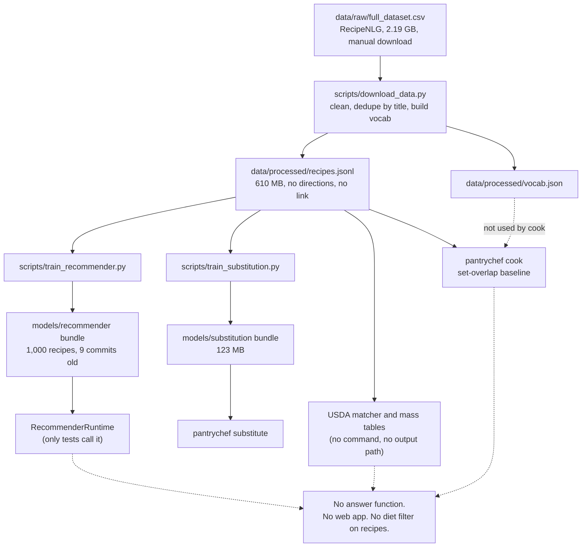

# PantryChef: project state

Date: 2026-10-30. Audited commit: `d49f02c`. Branch: `fix/parser-doubled-token-coverage`.
Sources: ADRs [0003](decisions/0003-licence-clean-recipe-corpus.md), [0004](decisions/0004-static-first-browser-engine.md), [0005](decisions/0005-honest-claims-and-eval-reset.md); the [Stage 1 synthesis](research/2026-10-stage1/README.md) and its [review](research/2026-10-stage1/REVIEW.md); the repo itself. For findings and fixes, read [TECHNICAL_AUDIT.md](TECHNICAL_AUDIT.md).

Labels: MEASURED (a run or a log shows it), ESTIMATE (a calculation), HYPOTHESIS (a test must confirm it).

## 1. Summary

PantryChef is meant to be a pantry-first recipe app. A user lists what they have. The app shows what they can cook now, and the top items that would move the most recipes to make now (on zero results, the single change that returns the most results). Today it is a Python library with 246 passing tests (MEASURED, 92% coverage). It has a parser, a recommender, a substitution model and a nutrition estimator. It has no app, no web page and no single "pantry in, answer out" function. The main published results do not survive a hard test. The project owner accepted three decisions on 2026-10-30. They change the data source, the hosting plan and the claims policy.

## 2. Status by capability

| Capability | Status | Evidence |
| --- | --- | --- |
| Ingredient parser (rules plus vocabulary match) | Built and tested | `pantrychef/ingredients/parser.py`; unit tests pass. Accuracy on a hand-labelled gold set: not measured |
| Set-overlap baseline retrieval and `cook` command | Built and tested | `pantrychef/retrieval/`, `pantrychef/cli.py:26` |
| Recommender: candidate pool plus LambdaMART (a learned ranking model) | Built, not usable by a person | Only tests call `RecommenderRuntime`. `cook` does not use it |
| Substitution model (graph and embedding arms) | Built and tested | `pantrychef/substitution/`; `substitute` command loads the 123 MB bundle (not run in this audit) |
| Dietary filter | Built, unsafe | Tagger judges 18.7% of the vocabulary. Wrong on gluten and vegan cases. See audit C2 |
| Nutrition estimate | Built, not fit to show | Wrong matches and masses. See audit C3 |
| Computer vision ("by photo") | Claimed but missing | `pantrychef/vision/__init__.py` holds a docstring only |
| Two-tower model, FAISS, Hydra, NER, ONNX | Claimed but missing | No code, no dependency |
| API server, web app, Docker path | Claimed but missing | `make serve` prints "Not implemented". A replica of the Dockerfile's `uv sync` step failed. No `docker build` was run |
| Production recommender bundle | Claimed but missing | Disk bundle holds 1,000 recipes; docs say it is the production model |
| Static web app with browser engine (ADR 0004) | Planned | No code yet |
| Wikibooks display pack, Open Recipes statistics (ADR 0003) | Planned | Measured in research only |
| Rebuilt ingredient table and vocabulary | Planned | Current `vocab.json` comes from RecipeNLG |
| New evaluation with hand-judged pantries (ADR 0005) | Planned | Not started |

## 3. Git state

- Branch `fix/parser-doubled-token-coverage` is checked out. Latest commit: `d49f02c` (style fix for the CI quality gate).
- PR #5 is OPEN and not merged (MEASURED with `gh pr view 5`). It holds the parser fix, the hash-order sampling, the 10k training cap and docs. The review says: merge it, then fix the docs in a follow-up PR.
- Tags: `v0.1.0`, `v0.2.0`, `v0.3.0`, `v0.4.0`. The package version is still `0.0.0` (`pantrychef/__init__.py:12`).
- Other branches: `main`, and remote-only `feat/phase3-full-corpus`, `feat/phase4-nutrition`.
- Modified, not committed: `ROADMAP.md` and `docs/decisions/DECISIONS.md`.
- New, not committed (new or changed docs): `CLAUDE.md`, `docs/ARCHITECTURE_PROPOSAL.md`, `docs/DEVELOPMENT_PLAN.md`, `docs/PRODUCT_VISION.md`, `docs/PROJECT_STATE.md`, `docs/RESEARCH_FINDINGS.md`, `docs/TECHNICAL_AUDIT.md`, ADRs 0003 to 0005 (`docs/decisions/0003-*.md`, `0004-*.md`, `0005-*.md`) and `docs/research/`.
- Other untracked: `.codegraph/`, `CODEX_HANDOFF.md`, `TestRun.md`, `scratch_codex_audit_prompt.md`, `temp_pytest/`.
- Untracked files `CODEX_HANDOFF.md` and ADRs 0003 to 0005 hold decisions that exist only on this laptop. Commit them.
- Corpus snapshots used for the ADR 0003 measurements are stored under `data/raw/`, which git ignores. Their sha256 hashes are in ADR 0003.

## 4. Actual data flow today

Where the flow breaks:

- `cook` does not use the parser, the vocabulary or the ranker (`pantrychef/cli.py:26-33`). It rebuilds the index on each call.
- The recommender runtime has no caller outside tests.
- The cleaning step drops `directions` and `link` and blanks `ingredients_raw` (`pantrychef/data/store.py:47`). Results cannot show steps or quantities.
- Nutrition has no link to any recipe output.
- The recommender has no diet input. Its `dietary_ok` feature is the constant `1.0` (`pantrychef/recommender/features.py:77`).

## 5. Artifacts on disk (MEASURED, 2026-10-30)

| Path | Size | Note |
| --- | --- | --- |
| `data/raw/full_dataset.csv` | 2,188.7 MB | RecipeNLG. No checksum. Do not load whole |
| `data/raw/dataset.zip` | 591.9 MB | Source archive |
| `data/raw/usda_fdc/` | about 100 MB | USDA FoodData Central, Foundation and SR Legacy |
| `data/raw/gismo/*.pkl` | 1.2 MB | GISMo gold files (CC BY-NC) |
| `data/processed/recipes.jsonl` | 610.3 MB | Cleaned recipes. Do not load whole |
| `data/processed/recipes.buggy.jsonl` | 624.9 MB | Pre-fix copy. Disposable |
| `data/processed/vocab.json`, `usda.json` | 0.5 MB, 2.2 MB | RecipeNLG-derived vocabulary cannot ship (ADR 0003) |
| `data/processed/*.log` | about 8 MB | Evidence logs. Git ignores them |
| `data/eval/subs_gold.csv`, `subs_gold_gismo.csv` | 2.7 KB, 166 KB | Git ignores both |
| `models/recommender/recommender_bundle.zip` | 0.3 MB | 3 models, 1,000 recipes, 767 groups |
| `models/recommender/learning_curve.json` | under 1 KB | Learning-curve output |
| `models/substitution/substitution_bundle.zip` | 122.9 MB | Mined from the pre-ADR corpus |
| `models/substitution/word2vec.kv` | 12.3 MB | Pickle-based gensim file |

## 6. What a person can run today

I confirmed each command exists in the code. I did not run them: free RAM is about 1 GB, and the recipe file is 610 MB.

| Command | Does | Needs |
| --- | --- | --- |
| `uv sync --all-extras` | Installs everything. `--extra dev` alone fails (7 test collection errors, per report 07) | uv |
| `uv run pytest` | Runs 246 tests (MEASURED by the coordinator) | all extras |
| `uv run pantrychef cook --have eggs,flour,milk --k 5` | Ranks recipes by overlap (`cli.py:26`) | `data/processed/recipes.jsonl` |
| `uv run pantrychef substitute butter --diet vegan --k 5` | Lists substitutes (`cli.py:43`). Choices: vegan, vegetarian, gluten_free, dairy_free | substitution bundle |
| `uv run python -m pantrychef.eval` | Prints P1 recall@10 (`eval/__main__.py`) | recipes and vocab |
| `uv run python -m pantrychef.eval.recommend_main` | Scores a saved bundle. Options: `--mask-fraction`, `--seed`, `--no-subs`, `--max-eval-queries` | bundle, recipes |
| `uv run python scripts/train_recommender.py` | Trains a bundle. Options: `--max-rows`, `--mask-fraction`, `--seed`, `--output`. Default cap 10,000 training queries | recipes. RAM-blocked here |
| `uv run python scripts/train_substitution.py` | Trains the substitution bundle | recipes |
| `uv run python scripts/download_data.py` | Cleans the raw CSV. It does not download it. You fetch the CSV by hand | `full_dataset.csv` |
| `uv run python scripts/reclean.py` | Re-cleans into a new file | raw CSV |

Not available: `make train` (prints "Not implemented"), `make serve` (prints "Not implemented"). Kaggle: run Kaggle tooling with `uvx kaggle`.

## 7. Published numbers

| Number | Verdict |
| --- | --- |
| P2 MRR 0.289 (graph) vs 0.259 (food2vec), n=82 | Reproduces. Does not support "beats": the 95% interval for the difference is -0.048 to +0.111. Retired as a headline (ADR 0005) |
| P3 recall@10 0.980 vs 0.746, 50k recipes, n=9,354 | Reproduces. Measures the query generator. A no-ML rule scores 0.975 on a 1,404-query set. Keep as a sanity test only |
| P3 full-corpus 7.7x lead, ceiling 0.706 | Pre-fix. No post-fix run exists (`MemoryError`). Retracted |
| "Saturates at 10k" (learning curve) | Not supported. The metric sees only the gold slot. Retracted |
| 100% dietary validity | Retracted. The check uses the same tagger as the filter, so it cannot fail |
| P4 nutrition coverage 0.800 / 0.487 | Retracted. First 5,000 rows only. Random sample: 0.710 / 0.439 |
| P1 F1 0.864, recall@10 0.873 | No log on disk. Unsupported |
| GISMo comparison | Pre-fix. Never rerun. Unsupported |
| 246 tests, 92% coverage | Stand |
| sub_fill null result (0.9349 vs 0.9347) | Stands. It is an honest null |

Full ledger: 43 claims. 14 FALSE, 11 UNSUPPORTED, 11 STALE, 7 TRUE ([report 07](research/2026-10-stage1/07_engineering_claims.md)).

## 8. Accepted decisions (2026-10-30)

- [ADR 0003](decisions/0003-licence-clean-recipe-corpus.md): the public app uses Wikibooks Cookbook (CC BY-SA 4.0, 3,800 recipes) for display and Open Recipes (CC BY 3.0, 173,276 recipes) for statistics only. RecipeNLG is for research. The vocabulary will be rebuilt. Open Recipes statistics ship only if mined swaps pass the M5 blind rating. Otherwise nothing from Open Recipes ships.
- [ADR 0004](decisions/0004-static-first-browser-engine.md): a static site on GitHub Pages with a small TypeScript engine in a Web Worker. Python stays the reference. A golden-file test must prove both give the same results.
- [ADR 0005](decisions/0005-honest-claims-and-eval-reset.md): retract the headlines. Keep masked recovery as a sanity test with the no-ML rule on the leaderboard. A learned ranker ships only if it beats the IDF rule on hand-judged pantries. Nutrition stays out of release 1. The diet filter is a three-state preference filter with no allergen claim. Every published number links to a results file.

## 9. Environment

- RAM: about 1 GB free of 16 GB. Full-corpus work is blocked.
- GPU: NVIDIA MX150 (small; not used by any current code).
- Disk: 48.6 GB free on `G:`.
- OS: Windows 10. Shell: PowerShell or Git Bash.
- Kaggle: use `uvx kaggle` for heavy jobs.
- Python 3.11 in CI (`.github/workflows/ci.yml`). Locked with `uv.lock`.
