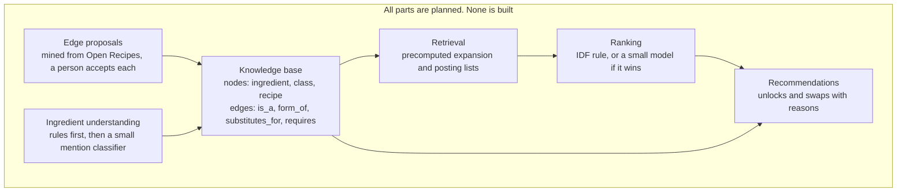

# 0006. Hybrid: a graph knowledge base with ML on top

- **Status:** Proposed. Nothing here is accepted or built. A spike in M3 decides.
- **Date:** 2026-10-30
- **Deciders:** Project owner (intent), Tech Lead

## Context

The owner intends a classical ML-backed project, not a recipe search with ML attached.
The direction to investigate is a structured, graph-based ingredient and recipe knowledge
base with carefully designed fast retrieval. ML would enhance retrieval, ranking,
ingredient understanding and recommendations. The owner does not want this forced if
research suggests a better approach, and does not want it lost.

The current plan pulls the other way:

- The ingredient table is "a table, not a true graph" in the worst case
  ([portfolio table](../DEVELOPMENT_PLAN.md#portfolio-coverage-and-its-honest-limit)).
- A deterministic rule ships unless a model wins ([ADR 0005](0005-honest-claims-and-eval-reset.md)).
- If all gates fail, the browser runs no ML.

The evidence so far does not show that a graph or a model helps. It also does not show
that they cannot:

- Graph MRR against word2vec has a 95% interval that includes zero (MEASURED, n=82).
- The top result for 50 common ingredients was usually a name variant (MEASURED, one rater,
  not blind).
- On pantries with distractors, an IDF rule led a retrained model at 10 and 20 extra items
  (MEASURED, no paired intervals, and the distractor sampler favours IDF).
- All of that work used RecipeNLG and a mined or leaked task. None of it tests a curated
  graph on real pantries.
- With about 3,800 recipes, an exact scan is possible (HYPOTHESIS until M1 measures
  latency). "Fast retrieval" therefore does not need approximate search. It needs a good
  index and a measured latency.
- The largest limit on ML depth is labels. The plan has up to about 1,500 human judgments
  (ESTIMATE). That suits a small model, not a large one (HYPOTHESIS).

This ADR does not weaken ADR 0005. It separates two questions, and each has its own test.

1. **Structure:** does a typed graph change results for the better, compared with a flat
   table?
2. **ML:** does a model on that structure beat the no-ML rule?

## What counts as a graph

We use the word "graph" for the product only if both conditions hold:

- The data has typed nodes and at least two typed edges that a query uses.
- A test shows that a traversal changes results, compared with the same data used as flat
  lookups.

Otherwise, the documents keep the word "table".

## Options considered

1. **Flat table and rules (current plan).** Cheapest, and serves users. It gives a weak ML
   story if the gates fail.
2. **Typed graph as a static artifact, with ML under gates (proposed).** Fits ADR 0004.
   Precompute traversals at build time and ship arrays and posting lists. ML runs at build
   time where it can, which avoids a second implementation in TypeScript.
3. **Knowledge graph embeddings or a graph neural network in the product.** Too little data
   and hard to explain. Parity with TypeScript is hard. Keep as a Kaggle research arm only.
4. **Graph database and a server.** Breaks ADR 0004 and needs a host. Rejected.
5. **Embedding-first retrieval (two-tower, approximate search).** No interaction data, and
   the corpus is small enough to scan. Rejected for the product.

## Proposed shape

| Layer | Idea | No-ML or flat baseline | Test |
| --- | --- | --- | --- |
| Knowledge base | Add `is_a` and `form_of` edges to the M3 table. Model curated swaps as `substitutes_for` edges | Flat table | Rows and edges carry provenance. Hand review of a sample |
| Retrieval | Expand a pantry through the edges. Direction matters: unsalted butter satisfies butter, and the reverse needs a decision. The bare "pepper" case in M3 is the same problem | No expansion | Share of pantries whose groups change, plus a hand-checked rate of false "make now" results |
| Ingredient understanding | A small classifier maps a mention to a node, at build time | Exact, synonym and fuzzy steps from M3 | Hand-labelled gold set, split into dev and test |
| Edge proposals | The existing context graph code proposes candidates from Open Recipes. A person accepts each one | Curated edges only | Acceptance rate. Mined edges without review follow the M5 rule |
| Ranking | Graph features, such as the role of a missing item, in a small model | IDF rule | M4 gate: paired 95% interval of the gain excludes zero, on human judgments |
| Recommendations | Weight `unlocks` by the graph | Count of recipes unlocked | Human judgments on held-out pantries |

Rules that stay in force:

- A metric that selects a model must not be a function of that model's features. Graph
  edges must not define the labels that judge a graph feature.
- Do not tune on the set you report on. Report paired intervals.
- No RecipeNLG-derived node, edge or model ships (ADR 0003). The FoodOn and Epicure data
  licences are unverified. Do not adopt them until someone verifies them.

## Decision rule

Run a spike of 2 to 3 days in M3 (ESTIMATE), on the dev pantries from M2. Fix these
thresholds before the spike starts. The values below are proposals, and the owner confirms
them then:

- Accept the graph if expansion changes the groups for at least 10% of dev pantries, and
  the false "make now" rate stays at or below 5% on a hand check.
- Otherwise, reject this ADR, keep the table and record the result.

ML layers do not depend on this rule. Each one has its own gate above. No new external
research was done for this draft. The spike must check the licences and the literature.

## Reconciling with current documents

- "A deterministic rule ships unless a model wins" stays true.
- "A table, not a true graph" becomes a testable outcome. It stays the honest worst case.
- ML at build time counts as ML in the product, if it passes its test. A browser with no
  model is no longer the same as a product with no ML.
- ADR 0005 can still leave a product with no shipped model. In that case, the ML work is a
  published research result. This ADR cannot promise more, and the owner should weigh it. The
  private RecipeNLG track on Kaggle could then give more training data for research only.

## Consequences

- Positive: a clear path to the owner's intent, with tests that can fail. The M3 table gains
  columns at a small cost, whichever way the spike goes.
- Negative: more design work in M3 and more arms to judge in M4. Wrong edges can create
  false "make now" results. Traversal logic adds parity cases, unless it is precomputed.
- Revisit when: the M3 spike ends, or M4 and M5 results change the balance.
