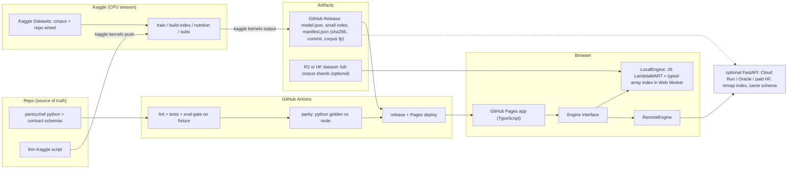

# PantryChef: deployment, serving, MLOps (report 05, 2026-10-30)

Labels: **MEASURED** (this machine), **DOCUMENTED (source, date)**, **ESTIMATE**. Web pages fetched 2026-10-30; several vendor pages returned truncated content and are flagged "unverified".

## 0. Findings that change the design

1. **MEASURED: the shipped recommender is tiny and cheap.** Production model `lambdamart-nosub` uses 6 features (coverage, match_frac_pantry, n_matched, n_missing, recipe_len, dietary_ok), all set-overlap arithmetic. Model JSON is 431 KB; the whole bundle zip is 306 KB. The bundle's `index.json` is only a **1000-recipe fixture index** (`metadata.recipe_count=1000`, commit a74280c); it does not contain the 1.27M corpus. Scoring is trivially portable to JS. The heavy part is candidate generation (the inverted index over the corpus).
2. **MEASURED: `RecommenderRuntime.load` loads the substitution lookup only if a model uses `sub_fill_*`** (`_bundle_needs_subs`). The production model does not, so word2vec and the 123 MB substitution bundle are not needed for recommendation. Substitution is a separate feature.
3. **MEASURED: Hydra is not used.** No `hydra`/`omegaconf` import in `pantrychef/`, `scripts/`, `tests/`, and not in `pyproject.toml`. `configs/config.yaml` is a dead placeholder. MLflow is only in the `substitution` extra. `Makefile` `train`/`serve` are echo stubs. `docker/` is a Phase 6 placeholder (compose references an MLflow server nobody runs). CI has only the lint/format/test job; the "eval-gate" is a comment.
4. **DOCUMENTED (https://huggingface.co/docs/hub/spaces-overview, 2026-10-30): creating a Docker or Gradio Space now requires a paid plan (PRO).** Only Static Spaces are free (plus 2 ZeroGPU Gradio Spaces for free accounts). Hardware: CPU Basic 2 vCPU / 16 GB / 50 GB non-persistent disk; free hardware sleeps when unused.
5. **DOCUMENTED (HF dataset card and access terms found via search, 2026-10-30; partial): RecipeNLG is "non-commercial research and educational" use; license listed "unknown".** No explicit public redistribution right found. See section 4.

## 1. Hosting options

| Option | Free tier | RAM | Cold start / sleep | Size limits | Request limits | Sustainability risk | CORS | Secrets |
|---|---|---|---|---|---|---|---|---|
| **GitHub Pages** | Free | static | none | Site 1 GB; repo 1 GB recommended; no per-file limit on the limits page (git push blocks >100 MB, ESTIMATE) | 100 GB/month soft bandwidth, 10 builds/h soft (not for Actions deploys), 10 min deploy timeout, 429 possible (docs.github.com/en/pages/getting-started-with-github-pages/github-pages-limits) | Low | `*` for static assets (ESTIMATE) | none |
| **HF Static Space** | Free | static | none | best-effort storage | n/a | Low-med | yes (ESTIMATE) | variables readable by client JS |
| **HF Docker Space** | **paid plan needed to create** | 16 GB | sleeps when idle | 50 GB ephemeral disk | ports 80/443/8080 | policy risk | app | Secrets supported |
| **HF Datasets/Hub as CDN** | public storage "best-effort" free; file max 500 GB; <100k files, <10k per folder (huggingface.co/docs/hub/storage-limits) | n/a | none | use few large files (Parquet) | not documented | Medium ("must be useful to community") | browser fetch + Range on `resolve/` URLs: ESTIMATE, **unverified**, test first | read token only if private |
| **Render free web** | 750 h/month | not on page (512 MB commonly cited, unverified) | spins down after 15 min, ~1 min cold start; no persistent disk (render.com/docs/free) | 1 instance | heavy egress can suspend | Medium | app | env vars |
| **Fly.io** | **no free tier for new accounts**; trial 2 VM-hours or 7 days (aggregators; official page not reachable) | n/a | n/a | n/a | n/a | n/a | n/a | n/a |
| **Koyeb** | 1 free instance, 512 MB, 0.1 vCPU, 2 GB SSD; scale-to-zero after 1 h; wake 1-5 s (third-party); Mistral acquisition reported Feb 2026 | 512 MB | see left | tight | n/a | Med-high | app | env |
| **Railway** | $5 one-time 30-day trial, then $1/month credit; 0.5 GB RAM (docs.railway.com/pricing/free-trial) | 0.5 GB | always on until credit ends | n/a | n/a | High | app | env |
| **Cloud Run** | 2M req, 180k vCPU-s, 360k GiB-s monthly, Tier 1, request billing (pricing page via search); needs billing account | up to 32 GiB (recall) | scale to zero; cold start = image pull + app load | image size | concurrency | Low, but card on file | app | Secret Manager |
| **Cloudflare Workers free** | 100k req/day; **128 MB, 10 ms CPU/request**, 64 MiB script, 50 subrequests (developers.cloudflare.com/workers/platform/limits) | 128 MB | ~none | too small for an index | see left | Low | app | yes |
| **Cloudflare R2** | 10 GB-month, 1M class A, 10M class B ops/month, **egress free** (developers.cloudflare.com/r2/pricing) | n/a | none | large objects OK | n/a | Low | configurable, Range supported | none if public |
| **Vercel/Netlify functions** | hobby tiers (not fetched) | ~1 GB | cold start | 50-250 MB bundles | non-commercial clause | Medium | app | yes |
| **Oracle Always Free** | A1 documented 4 OCPU/24 GB; reports of halving to 2 OCPU/12 GB from 2026-06-15 (conflicting); idle reclamation (<15-20% util, 7 days) | 12-24 GB | always on | big | n/a | High | self | self |
| **AWS Lambda** | 1M req/month (recall, unverified) | up to 10 GB | cold start with large deps | 250 MB zip / 10 GB image | n/a | Low | via gateway | yes |
| **jsDelivr** | free CDN for GitHub/npm | n/a | none | ~20 MB per GitHub file (recall, unverified) | n/a | Medium | `*` | none |

Takeaway: no free host gives a reliable always-on multi-GB Python process. Static hosting plus an object store is the only durable zero-cost shape.

## 2. Architectures

### Sizing from a real sample (MEASURED on the first 20,000 lines of recipes.jsonl)
- Raw jsonl 367 B/recipe (610 MB / 1.27M agrees). Fields: id, title, ingredients_raw, canonical. No directions in the processed file. Mean 7.4 canonical ingredients per recipe.
- gzip per recipe: vocab-indexed ids JSON 22 B; titles 7.5 B; title + raw ingredient strings + ids 72.5 B.
- ESTIMATES derived from these: inverted index as delta-varint rows about 2 B/posting, so about 15 B/recipe; forward index (recipe to ingredient ids) about 15 B/recipe; quantised nutrition (4 x u16) about 8 B/recipe.

| Corpus | Core download (postings + forward + titles + nutrition) | Raw ingredient text (lazy shards) | Browser memory |
|---|---|---|---|
| 100k | about 4.5 MB | +6 MB | 25-40 MB |
| 250k | about 11 MB | +15 MB | 50-80 MB |
| 1.27M | about 55-60 MB | +85 MB | 150-250 MB (risky on low-end phones) |

Query latency in the browser (ESTIMATE): Python was about 89 ms/query before the 37x vectorisation; the same algorithm on Int32Array postings plus 200 x 6-feature tree scoring should be 10-60 ms at 100k, a few hundred ms at 1.27M when the pantry contains salt/sugar-class ingredients (about 0.5M-row postings). Measure before promising.

### A. Fully static
- Hosting: GitHub Pages for app + core index (<20 MB); R2 or HF dataset for big shards.
- Inference: LightGBM text model walked in about 60 lines of JS (no ONNX/WASM; float64 thresholds, same arithmetic as the C++ predictor). ONNX Runtime Web is the fallback if the model grows (about 10 MB wasm).
- Substitution: precomputed top-k table over the roughly 30k vocab (30k x 10 x 4 B = 1.2 MB raw, under 1 MB gz) generated by `pantrychef.substitution`. Optional: int8 word2vec (12.3 MB fp32 to about 3 MB) with live cosine top-k in JS (30k x ~100 dims, a few ms).
- Nutrition: per-recipe, precomputed by `pantrychef.nutrition` from USDA (public domain). The 2.2 MB `usda.json` is not shipped.
- SQLite-WASM with HTTP Range (sql.js-httpvfs pattern) and DuckDB-WASM/Parquet: viable for the detail lane (titles/raw ingredients) at 1.27M, but add 1-4 MB wasm and many round trips; candidate generation is better as typed-array postings. Needs Range + CORS; R2 yes; Pages/HF must be tested.
- Pyodide: about 10 MB runtime + numpy/pandas (tens of MB), seconds to boot on mobile. Rejected for the app; it runs repo Python unchanged (parity win) but is too heavy. Use it, if at all, only as a CI-side oracle.
- Gap: `canonicalize` (free-text normalisation) is Python. Avoid porting: the UI forces a pick from the 30k-vocab autocomplete (plus an alias map for common spellings), so every pantry item is already a canonical id.

### B. Static frontend + small Python API
- Needs an always-on host: only Cloud Run (billing account), Oracle (shaky), Render (1 min cold start) or paid HF. 512 MB hosts are borderline.
- Current runtime does not fit: MEASURED about 54 s load, 79 s index build, 2.8 GB peak. Compaction: postings as one int32 `.npy` + offsets read with `np.load(mmap_mode="r")` (about 38 MB postings + 5 MB lengths); titles/raw strings in SQLite keyed by row (no FTS needed). RSS about 100-150 MB, cold start about 3-6 s (ESTIMATES, dominated by numpy/lightgbm import).
- Benefit: full 1.27M corpus, real Python free-text canonicalisation, future CV (P5). Cost: availability, CORS, abuse handling, dies when the free host changes policy.

### C. Hybrid
Static core (A) is the product; the same contract is also served by an optional FastAPI adapter (B) for full-corpus mode, free-text parsing and later image upload.

### Recommendation: A first, hybrid (C) later
1. Ship **A** with a curated **100k-150k recipe subset** (hash-order sampling already exists in `scripts/recommender_learning_curve.py`; filter `min_recipe_len`). Core about 5-7 MB, loads in seconds on a phone, free forever on Pages.
2. Smaller is also the better-measured operating point: repo findings show the candidate ceiling collapsing 0.983 to 0.706 at 1.27M (retrieval is the bottleneck). Say so honestly.
3. Offer "full corpus" as a desktop tier: binary shards on R2 (free egress), same engine code.
4. Build FastAPI (B) only when vision or free text needs it, behind the same schema.

**Real ML vs precomputed (interview framing):** live in the browser are candidate generation (overlap over the inverted index), feature extraction and **scoring with the exact LambdaMART trained by the repo**, optionally embedding top-k. Precomputed by the repo pipeline on Kaggle: index serialisation, per-recipe nutrition, substitution table, model training. Every artifact carries commit SHA and corpus fingerprint.



## 3. Contract and decoupling

- Define request/response as pydantic models in the repo (`pantrychef/contract/`): `RecommendRequest{pantry: list[ingredient_id], k, dietary}`, `RecommendResponse{results:[{recipe_id, score, matched, missing, nutrition}], model:{name, commit, corpus_fp}}`. Export `openapi.json` (FastAPI `app.openapi()` works without running a server); generate TS types in CI with `openapi-typescript`.
- Frontend codes against `interface Engine { recommend(req); substitute(req); }`. Adapters: `LocalEngine` (default) and `RemoteEngine` (base URL from config). Changing host = changing a URL/adapter.
- Parity: `scripts/make_golden.py` writes `golden/recommend_cases.json` with about 200 fixed pantries over the fixture corpus: candidate row list, feature matrix, Python scores, top-10 ids. A `node --test` job runs the JS engine on the same index and asserts (a) feature matrix equal within 1e-9, (b) scores within 1e-9 (both float64), (c) identical top-10 including the `(-score, recipe_id)` tie-break from `rerank`, (d) JS candidate order equals Python `candidate_pool` (lexsort: -coverage, missing, id_rank). CI regenerates goldens and fails on `git diff`, so Python changes cannot silently drift from JS.

## 4. Artifact/data versioning and licences

- **Lightest provenance**: one `manifest.json` per release listing each artifact with sha256, size, git commit, corpus fingerprint (already produced by `bundle.corpus_fingerprint` and stored in bundle metadata), seed, metrics, Kaggle kernel version. Small artifacts (model.json, subs table, small index, manifest) are **GitHub Release assets** on a tag; large shards go to R2 or an HF dataset repo, referenced by sha256 in the manifest. The Pages build downloads release assets and verifies hashes; nothing large lives in git.
- **No DVC**: an extra tool and remote; manifest + immutable tags gives the same reproducibility at this scale.
- **MLflow**: keep as optional local tracker (`mlruns/` is already gitignored). Delete the MLflow service from `docker-compose.yml`; copy the run summary into the manifest.
- **Hydra**: unused; delete `configs/config.yaml` and any doc claims, unless a real consumer appears. `RecConfig` plus CLI args is the actual config system, and it is stored in the bundle manifest (better provenance).
- **Delete/adopt**: delete `docker/` placeholders until an API exists; add `.github/workflows/{pages,release}.yml` and an eval-gate job; add `kaggle/` with metadata and script.
- **Licences (not legal advice)**:
  - RecipeNLG: non-commercial research/educational terms, no explicit redistribution right, license "unknown". Publishing 100k recipes' text on Pages is a **real risk**. Mitigate: ship only title + canonical ingredient ids + link to the source; keep `ingredients_raw` out of the public payload; label it a non-commercial research demo; contact the dataset authors; never publish the 610 MB jsonl. Fallback: smaller sample or a permissively licensed corpus.
  - GISMo data (CC BY-NC): evaluation only, attribution, not in shipped artifacts.
  - USDA FDC: public domain; precomputed nutrition is safe.
  - word2vec/embeddings trained on RecipeNLG: derived model, lower risk, same caveat.

## 5. Kaggle workflow

Status: **MEASURED** `kaggle` is not on PATH; `uv 0.10.8` is present; `~/.kaggle` has one file (not read). Install with `uv tool install kaggle`; verify with `kaggle --version` and `kaggle kernels list --mine`. Credential format (legacy `kaggle.json` vs newer token / `KAGGLE_API_TOKEN` env) not verified. **DOCUMENTED** metadata fields (github.com/Kaggle/kaggle-api docs/kernels_metadata.md, 2026-10-30): id, title, code_file, language, kernel_type, is_private, enable_gpu, enable_internet, machine_shape, dataset_sources, competition_sources, kernel_sources, model_sources.

Quotas (secondary sources only, official page returned no values; ESTIMATE): about 30 GPU hours/week, sessions up to 9-12 h, about 29 GB RAM and 4 CPUs, internet off by default and needs phone verification. LightGBM and word2vec are CPU work, so GPU quota is irrelevant.

Flow (nothing run):
1. Datasets: `kaggle datasets create -p kaggle/data_corpus` (raw RecipeNLG, private) and `kaggle/repo_wheel` (wheel built in CI from a tag/SHA, plus a `SHA` file). Offline kernel, pinned code, no internet needed.
2. Thin script `kaggle/run.py` (kernel_type `script` so diffs are reviewable):

```python
import pathlib, subprocess, sys
wheel_dir = pathlib.Path("/kaggle/input/pantrychef-wheel")
sha = (wheel_dir / "SHA").read_text().strip()
subprocess.check_call([sys.executable, "-m", "pip", "install", "--no-deps", *map(str, wheel_dir.glob("*.whl"))])
subprocess.check_call([sys.executable, "-m", "pantrychef.pipeline", "build-release",
                       "--corpus", "/kaggle/input/pantrychef-corpus/recipes.jsonl",
                       "--out", "/kaggle/working/release", "--commit", sha])
```

   `pantrychef.pipeline build-release` is a to-be-written thin CLI wrapping the existing `scripts/train_recommender.py`, subs table, nutrition and index export, and emitting `manifest.json`.
3. `kaggle/kernel-metadata.json`:

```json
{
  "id": "YOUR_USER/pantrychef-build",
  "title": "pantrychef-build",
  "code_file": "run.py",
  "language": "python",
  "kernel_type": "script",
  "is_private": "true",
  "enable_gpu": "false",
  "enable_internet": "false",
  "dataset_sources": ["YOUR_USER/pantrychef-corpus", "YOUR_USER/pantrychef-wheel"],
  "competition_sources": [],
  "kernel_sources": [],
  "model_sources": []
}
```

4. `kaggle kernels push -p kaggle/` then `kaggle kernels status YOUR_USER/pantrychef-build` then `kaggle kernels output YOUR_USER/pantrychef-build -p out/` then `gh release create vX.Y.Z out/release/*` after hash check against the manifest.
5. Secrets: none in the kernel. Never put GitHub/HF/R2 tokens in Kaggle; publish from the laptop or CI.
6. Expected runtime (MEASURED, repo notes): production recommender training about 25 min at the 10k cap; full-corpus index about 31-42 min. Both fit one CPU session.

## 6. CI/CD

Exists: one `quality` job (ruff check, ruff format --check, pytest --cov) with substitution/recommend/nutrition extras. Missing: eval gate, Pages, release, JS tests.

Minimal additions:
1. **eval-gate**: run `python -m pantrychef.eval` on the committed small fixture; compare MRR/recall with a committed `tests/golden/baseline_metrics.json`; fail on more than -0.02 absolute drop.
2. **parity**: `python scripts/make_golden.py && git diff --exit-code golden/` then `node --test web/test/`.
3. **pages**: on push to main, `actions/upload-pages-artifact` + `actions/deploy-pages` (an Actions deploy bypasses the 10 builds/hour soft limit); fetch release assets and verify sha256 first.
4. **release**: `workflow_dispatch`/tag job uploads Kaggle outputs to a GitHub Release using only `GITHUB_TOKEN`; R2/HF publishing, if used, needs a bucket-scoped token in a protected environment.
5. Pin actions by SHA; default `permissions: contents: read`; grant `pages: write` and `id-token: write` only to the deploy job.

API-only security (adapter B): CORS allowlist = the Pages origin, never `*` with credentials; pydantic bounds (pantry <= 40 items, ids <= 64 chars, k <= 50); per-IP rate limit (slowapi or edge); request body cap; no secrets in the browser. For future image upload: <= 5 MB, content-type + magic-byte check, decode and re-encode with Pillow (strips EXIF), pixel-count cap, no persistence, inference timeout.

## Risks and unknowns to resolve first
1. RecipeNLG redistribution (highest; blocks public recipe text).
2. Pages/HF Range + CORS unverified; test with `curl -I -H "Range: bytes=0-99" URL`.
3. JS candidate-generation latency at 100k-1.27M is estimated, not measured.
4. Kaggle quotas and credential format unverified; Fly/Koyeb/Railway/Oracle figures are secondary sources.
5. The shipped recommender bundle holds a 1000-recipe index; the pending production retrain (RAM-blocked) and the static index export must record the chosen subset's fingerprint.
