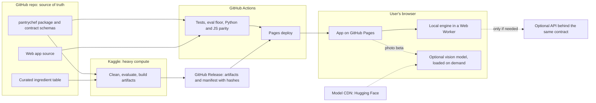

# Stage 1 synthesis: PantryChef audit, 2026-10-30

Status: research only. No product code changed. Audited commit: `d49f02c`.
An independent review returned GO WITH FIXES. This version includes its fixes
([review](REVIEW.md)).

**Superseded in part.** The owner decided on 2026-10-30 to build first with a
licence-clean corpus. ADRs 0003 to 0005 and `docs/DEVELOPMENT_PLAN.md` replace the
direction, sequence and decision sections below. The findings stay valid. This file is
kept as a record.

The numbered reports in this folder hold the detail. `evidence/` holds the scripts
that produced their measurements. Some scripts contain absolute paths from the
audit session.

Publication check, 2026-10-30: `evidence/subs_out.json` is not committed, because it holds
output of a model trained on RecipeNLG, with corpus counts. Run `evidence/run_subs.py` to
rebuild it. RecipeNLG recipe titles in the reports are replaced with descriptions. Repeated
library warnings are removed from `evidence/review/rec_spread.out`. No result line changed.

Labels: **VERIFIED** means evidence exists in code, logs or a run. **HYPOTHESIS**
means an experiment must confirm it. **ESTIMATE** means a calculation, not a
measurement.

| Report | Scope |
| --- | --- |
| [01](01_recommender.md) | Retrieval and ranking |
| [02](02_substitution.md) | Substitution and dietary guardrail |
| [03](03_vision.md) | Computer vision |
| [04](04_product.md) | Product and user experience |
| [05](05_deployment.md) | Deployment and MLOps |
| [06](06_data_nutrition.md) | Data, parser and nutrition |
| [07](07_engineering_claims.md) | Engineering and claims ledger |

## 1. Verdict

The code is clean and well tested: 246 tests pass with 92% coverage. The product
does not yet work, and the main claims do not survive a hard test.

The claims ledger checked 43 documented claims: 14 false, 11 unsupported, 11 stale
and 7 true. `docs/EVALUATION.md` is mostly honest. `README.md`, `ARCHITECTURE.md`
and `ROADMAP.md` describe the plan as if it were built.

## 2. Findings that change the plan

### 2.1 The recommender headline measures the query generator (Critical, VERIFIED)

`make_query` builds each test pantry by removing 30% of one recipe's ingredients.
The pantry is therefore always a subset of the correct recipe. The pantry also has
no unrelated items. A real pantry has both properties reversed.

Two agents tested this independently with rules that use no machine learning:

| Test | Overlap | No-ML rule | LambdaMART |
| --- | --- | --- | --- |
| 50k recipes, 1,404 queries, recall@10 | 0.740 | 0.975 | 0.980 (log, different set: 9,354 queries) |
| 20k recipes, 1,500 queries, MRR@10 | 0.544 | 0.952 | 0.958 |

Results depend on the slice. Overlap MRR is 0.693 on a sample spread through the
corpus, against 0.544 on the first 20k.

The review tested pantries with extra items sampled by corpus frequency (recall@10
on a 20k spread sample):

| Extra items | Overlap | Fraction rule | Model, clean training | Model, retrained on extras | IDF cosine rule |
| --- | --- | --- | --- | --- | --- |
| 0 | 0.699 | 0.994 | 0.995 | 0.995 | not run |
| 10 | 0.322 | 0.853 | 0.601 | 0.943 | 0.958 |
| 20 | 0.113 | 0.693 | 0.361 | 0.830 | 0.914 |

At 3 extra items the retrained model scored 0.985 and the IDF rule 0.980.

The model trained in the current way falls below a one-line rule when pantries hold
unrelated items. Retraining helps, but the reranker shows no demonstrated lead over
the IDF rule. These tests have no paired intervals, and frequency-sampled extras
favour IDF, so other samplers must be tested.

The identical learning-curve metrics are explained, with no bug found. A review
rerun at caps of 4k and 8k gave different models with the same gold rank on 2,000
of 2,000 queries, and only 378 of 2,000 top-10 lists matched. The metric sees only
the gold slot. "Saturates at 10k" therefore is not supported.

The full-corpus lead of 7.7 times is from before the parser fix. No rule ran above
50k, so the same inflation there is likely but unmeasured.

### 2.2 The dietary guardrail is unsafe and its metric cannot fail (Critical, VERIFIED)

"100% validity" re-checks results with the function that filtered them. Direct
checks at this commit:

| Ingredient | Diet | Result | Correct? |
| --- | --- | --- | --- |
| egg noodle | gluten free | allowed | No, wheat |
| cream of mushroom soup | gluten free | allowed | No, usually wheat |
| chicken noodle soup | gluten free | allowed | No, wheat |
| peanut butter, coconut milk | vegan | blocked | No, plant foods |
| salt | vegan | blocked | No |
| rice | gluten free | blocked | No |
| onion | vegetarian | blocked | No |

The tagger judges 18.7% of the vocabulary. The conservative default blocks the
rest, so applying it as a vegan recipe filter would keep about 0.01% of sampled
recipes. No recipe filter exists today. The guardrail reaches substitutions only.

### 2.3 Nutrition output is not fit to show (Critical, VERIFIED)

Direct checks of the USDA matcher: `oil` matches bearded seal oil, `sugar` matches
brown sugar, `whole milk` matches mozzarella and `egg` matches frozen scrambled egg.
"3 cloves garlic" becomes 408 g. A mangled source line ("13 cup soy sauce", from
1/3) produced a 43,568 kcal recipe. Coverage on a random sample is 0.710 match and
0.439 mass, not the published 0.800 and 0.487, which come from the first 5,000 rows.

### 2.4 The flagship does not yet beat its baseline (High, VERIFIED)

The published numbers reproduce exactly. They do not support the claim:

- Graph minus embedding MRR is +0.030, with a 95% interval of -0.048 to +0.111, at
  n=82. The difference is not distinguishable from zero.
- The shrinkage parameter was tuned on the same 82 queries.
- The gold set is mined from the training corpus and 36% of its pairs are name
  variants.
- The GISMo row is from before the parser fix and was never rerun.
- A hand check of the top result for 50 common ingredients gave 39 name variants,
  5 real substitutes, 4 usable with a caveat and 2 wrong. One person rated this,
  not blind, so treat it as indicative. This replaces the 12/24/6/8 count in report
  02, which mixed in lower-ranked results.

### 2.5 The dataset licence is an unresolved launch risk (Critical, VERIFIED in part)

The RecipeNLG access terms allow non-commercial research and educational use. They
allow sharing with colleagues who accept the same terms. We found no grant of a
public right and no explicit ban. The official terms page did not render for us, so
we read the terms through dataset card excerpts. Also, 26.4% of raw rows and 31.9%
of kept rows are tagged `Recipes1M`, which has separate terms.

There are two separate questions. The dataset terms are a contract. Copyright is
different: US guidance says bare ingredient lists are not protected, but descriptive
text can be. Publishing instructions is the most exposed choice.

Static hosting adds exposure in degree only. Text shards are a bulk download, while
shards of ingredient ids reveal far less. An API also shows data to people who did
not accept the terms.

This is not legal advice. The authors at Poznań University of Technology can speak
for RecipeNLG. They cannot clear Recipe1M or the rights of the source sites.

### 2.6 The vocabulary is a shared defect (High, examples VERIFIED)

The examples below are verified. The claim that fixing the vocabulary repairs most
failures is a HYPOTHESIS. Other failures have separate causes: first-hit USDA
matching, the `each` mass fallback, mangled fractions and the tagger's token logic.

- `garlic` and `clove garlic` are separate, so a pantry with garlic misses about 45%
  to 47% of garlic recipes (two sample measurements).
- Synonyms are separate entries: scallion and green onion, eggplant and aubergine.
- About 35% of a 200-entry sample is junk or brand names. `large` occurs 67,381
  times.
- The singulariser produces `asparagu`.

This defect affects retrieval, substitution, autocomplete and any future vision
mapping.

### 2.7 There is no product path (High, VERIFIED)

- No single function goes from pantry to answer. `pantrychef cook` uses the baseline
  and does not use the parser, the vocabulary or the ranker.
- Cleaning drops directions, link and source.
- The "production" bundle holds 1,000 recipes and is 9 commits old.
- The full-corpus rerun after the parser fix ended in `MemoryError`. No post-fix
  full-corpus result exists.
- Deduplication uses title only. It removes about 43% of rows, and these are mostly
  different recipes with the same name.
- A fresh clone fails the README quickstart with 7 test collection errors.

## 3. Disagreements between agents and how we resolved them

| Question | Positions | Decision |
| --- | --- | --- |
| What recipe text can ship? | 04: show titles and ingredient lines. 05: titles and ingredient ids only. 06: no RecipeNLG text. | Unresolved. See decision D1. Build the recipe corpus as a replaceable pack. |
| Static or API? | 05 prefers static. Licence exposure favours an API. | Static stays the default because free always-on hosts do not exist. The licence decision must come first. |
| How to choose the 100k to 300k subset? | 05: hash sample. 01 and 06: filter on quality and deduplicate. | Filter on quality and deduplicate. A random sample keeps the junk. |
| Train on graded "makeability" labels? | 01 proposes this and says the label does not depend on a generator. | Rejected as stated. The label would be a function of `n_missing`, which is a feature, so this repeats the circularity. Rank with the IDF rule first. A learned ranker must beat it on hand-judged data. |
| LambdaMART in the browser as "real ML"? | 05 uses it as the interview story. 07 shows it is close to one rule. | Do not sell this story yet. The JavaScript port stays small, but only build it if the ranker earns its place. |
| Show precomputed nutrition per recipe? | 05 assumes yes. 06 shows the values are wrong. | Hide nutrition until a validation against USDA FNDDS recipes passes. |
| Recipes1M share of the corpus | 04: about 31%. 06: about 45%. | Resolved by a full count: 26.4% of raw rows, 31.9% of kept rows. Report 06 is wrong. |

## 4. Recommended direction

### 4.1 Product

The core promise: "Tell me what I have. Show what I can cook now, and the one item
that unlocks more." The first version has autocomplete chips, a quick-pick grid,
assumed staples, "make now" and "one item away" sections, and a pantry saved in the
browser. It has no accounts.

The data has no images, ratings, cooking time, servings or cuisine. Typographic
cards replace images. Filters on those fields do not exist in the first version.

Photo input comes after the core works, and only if it passes its own test.

### 4.2 Shared ingredient table (new idea from the synthesis)

Build one curated table. Each row holds the display name, synonyms, functional
role, diet flags with three states (safe, unsafe, unknown), the USDA food id and a
visual label. One table can then serve autocomplete, retrieval, substitution gating,
dietary filters, nutrition matching and vision mapping (HYPOTHESIS).

Do not start with 3,000 hand-written rows. Start with rule-based collapsing and
about 500 rows, then measure. Mention coverage also hides a gap at recipe level.
Before collapsing:

| Top N entries | Mentions covered | Recipes fully covered |
| --- | --- | --- |
| 300 | 63.6% | 5.4% |
| 500 | 70.8% | 9.1% |
| 1,000 | 79.8% | 19.3% |
| 3,000 | 90.9% | 48.4% |

Limiting the served corpus to fully covered recipes removes most "unknown" states.
The dietary output is a preference filter, not allergen advice. If allergen data is
added, it must use "may contain" wording.

### 4.3 Machine learning that earns its place

| Area | Plan | Status |
| --- | --- | --- |
| Candidates | Length-normalised IDF cosine or BM25. Do not use report 01's normalised coverage form, which scored 0.194 at 20 extras against 0.914. Reject approximate nearest neighbour search, because exact set matching is a lexical task. | HYPOTHESIS, Kaggle test under 30 min |
| Ranking | IDF rule first. The portfolio deliverable is a ranker with features independent of overlap (IDF, title frequency, cluster size, ingredient typicality) that must beat the IDF rule on hand-judged pantries. If it loses, the IDF rule ships and the result is reported. | HYPOTHESIS |
| Recipe quality | Near-duplicate cluster size and structural filters. A classifier from a rated corpus is optional. | HYPOTHESIS |
| Substitution | Curated functional table first, then mined model limited to the same role, then "no confident swap". Precomputed table of about 2 MB replaces the 123 MB bundle. | HYPOTHESIS, blind rating test |
| Vision | No YOLO from Ultralytics, because of AGPL. SigLIP2 or OpenCLIP on image tiles, in the browser, against about 150 to 200 items. No boxes. Ship only at per-photo F1 of 0.5 or more and 5 edits or fewer. | HYPOTHESIS, no fridge benchmark exists |

The audit gives a strong interview story: a metric that looked excellent, the test
that falsified it, and the better protocol that replaced it. It does not replace a
built deliverable. The ranker test and the substitution system above supply that.

### 4.4 Evaluation

- Keep recovery as a sanity test only. Add the no-ML rule to its leaderboard.
- Add pantries with distractors, using more than one sampler for the extra items.
- Report "makeable at k" with staples excluded as a product metric only. Sorting by
  missing count wins it by construction, so it cannot select a ranker.
- Add a hand-judged set: 100 pantries, top 5 from 3 systems, with bootstrap intervals.
  It can select a ranker. It is too small to train one. Training labels need an
  external source, such as a rated corpus whose licence passes review, or a signal
  independent of overlap.
- Use a dev and test split for substitution queries. Report paired intervals.
- Validate parser output against a hand-labelled 300-line gold set.
- Validate nutrition against 500 USDA FNDDS recipes.
- Write each result as JSON with commit, dirty flag, config, corpus fingerprint and metrics.

### 4.5 Architecture

The frontend codes against one engine interface, so a host change needs only a new
adapter. No secrets exist in the browser, because the static path needs none.

Hosting facts that drive this choice:

- Hugging Face Docker and Gradio Spaces now need a paid plan to create. Static
  Spaces stay free (VERIFIED in the official docs, 2026-10-30).
- Fly.io has no free tier for new accounts (secondary sources).
- Render free sleeps after 15 minutes and takes about 1 minute to wake (official
  docs, per report 05).
- GitHub Pages allows a 1 GB site and 100 GB per month of soft bandwidth.
- A corpus of 100k recipes needs about 4.5 MB of core data with nutrition (ESTIMATE
  from a 20k sample). The review measured 3.44 MB without nutrition, links, directions
  or about 7 MB of raw text. Browser latency is not measured.

## 5. Recommended sequence

Steps 1 to 3 start now. The licence decision runs alongside them and has a time
limit, so it does not stop engineering work.

1. **Reset:** merge PR #5, fix the quickstart, make the README honest, and delete
   Hydra, the MLflow dependency and placeholder files. Report 05 would keep MLflow as
   optional. We delete it because 4 runs logged no metrics and it adds dependency
   weight to serving.
2. **Thin slice:** one `answer()` function, a static page, a small corpus and an IDF
   score, deployed privately. This exposes contract problems early.
3. **Baseline evaluation:** new protocols and rule baselines on the current data, so
   each later change has a before and after.
4. **Data foundation:** rule-based collapse, a first ingredient table of about 500
   rows, a Kaggle reclean that keeps directions, link and source, correct
   deduplication, stable recipe ids and a stored split.
5. **Retrieval and ranking:** IDF or BM25, then the ranker test.
6. **Trust layer:** tri-state dietary flags, curated substitutions with the mined
   fallback, and explanations. Fix nutrition or keep it hidden.
7. **Product:** the full contract and the complete app.
8. **Deployment:** public Pages site, release artifacts and CI parity tests. The
   recipe data must have passed D1 by this point.
9. **Vision beta:** test first, then ship only if it passes the gate.

## 6. Decisions for the project owner

- **D1, recipe data.** Ask the RecipeNLG authors for written permission, with a limit
  of about two weeks (a suggested limit). Ask about derived artifacts too: the
  substitution table, the ranker and frequency lists. Keep the recipe pack replaceable.
  If the answer is no or there is no answer, choose from: Open Recipes (CC BY 3.0,
  rights of individual entries unverified), Wikibooks Cookbook (CC BY-SA), tastyR
  (CC0, about 14k scraped recipes, provenance unverified), or a demo that shows no
  recipe text and links to sources. A `Gathered`-only filter (867,187 kept recipes)
  avoids the Recipes1M terms and most mangled fractions. It does not clear RecipeNLG.
- **D2, flagship story.** Move the headline from "graph beats food2vec" to honest
  evaluation and a useful substitution system.
- **D3, nutrition.** Keep nutrition out of the first release unless validation passes.

## 7. Limits of this audit

- No full-corpus experiment ran. All proposed Kaggle work is unrun.
- Vision accuracy, browser latency and quality-signal value are unmeasured.
- Competitor research covered some products only. Samsung Food, Plant Jammer, Tasty,
  Allrecipes and Spoonacular have no sourced detail.
- Kaggle quotas and several hosting limits come from secondary sources.
- `pip-audit` flagged 16 packages. Reachability was not assessed.
- Licence conclusions are an engineering reading, not legal advice.
- The review did not recheck the fresh-clone failure or the hand labels behind the
  36% and 35% figures. It also did not recheck most hosting facts or anything at full
  corpus.
